# Bayn deployment

## Jev 1.14 cutover

[The Box cutover](../../../docs/bayn/jev114-box-cutover.md) first settles the exact v39 PAPER identity through migration 186 and native OBSERVE recovery. The old mandate remains absent until the new protocol and verified immutable image have a reviewed same-account activation request.

## Images and operating commands

The `bayn` image serves status, execution, activation and market projection. It retains `bayn-forward-performance`
for private financial reports in the API workload. The trading artifact retains its replay executable and compiler
receipt for candidate image-membership qualification; the registered trading digest remains authoritative.
The `bayn-research` image owns research, replay, GEPA, frozen
controls and `bayn-system-assessment`. Qualification flags (`--system-*`) move to that command; the financial
report command rejects them. Both artifacts publish as one commit- and run-bound Kargo cohort. Trading and research
workload credentials and network policies remain separate. Operator qualification commands need their existing
explicit target configuration; the research service's scoped database identity is not a financial-report credential.

## Streaming broker delivery

`bayn-broker-feed` runs Dorvud's `BrokerFeedMain` for the existing Bayn PAPER account. It verifies `/v2/account`
with the loaded `bayn-alpaca-auth` credentials before subscribing to the authenticated trade-update socket through
`bayn-egress-proxy`. Each session boundary and trade update is signed and acknowledged by Kafka before the next
publication. The Kafka key is the Bayn broker identity hash. Collector readiness requires a verified account,
authenticated/listened socket and an acknowledged session notification; a listening HTTP port alone is insufficient.

```mermaid
flowchart LR
  Alpaca[Bayn PAPER account] -->|verified GET and authenticated WS| Dorvud[Bayn Dorvud broker feed]
  Dorvud -->|signed notifications, acks all| Kafka[bayn.broker-notifications.v1]
  Kafka -->|dedicated consumer group| Adapter[Pinned Restate Kafka ingress]
  Adapter -->|fixed target, record key and metadata| Notify[BaynBrokerObservations.notify]
  Notify -->|verified notification| Capture[Canonical broker reads and reconciliation]
  Capture --> Wake[Durable decision and execution wake]
```



`broker-kafka-ingress.yaml` pins upstream Restate Kafka ingress 0.1.1 by digest. Its published image is
linux/amd64, so only this adapter has an architecture constraint. The static mapper always invokes
`BaynBrokerObservations/notify`; the record key becomes the object key and Kafka topic, partition, offset and timestamp
remain attached. Its group is `bayn-broker-notifications-restate-v1`. The adapter sends into Restate's durable ingress,
independently of handler completion; no Bayn broker consumer or embedded Restate subscription competes for this topic.
The topic keeps seven days of individual events without compaction, with three replicas and a two-replica minimum ISR.
Restate 1.8.1 or later is required. See the [upstream integration contract](https://docs.restate.dev/services/integrations/kafka)
and [0.1.1 configuration](https://github.com/restatedev/ingress-integration-kafka/blob/v0.1.1/CONFIGURATION.md).

The receiver independently checks the current account, credentials, HMAC, Kafka identity key and session lineage.
Notifications wake the canonical financial owner; source WebSocket frames cannot post fills or change capital authority.
Market workers use `RESTATE_INGRESS_ORIGIN` to send authenticated advisory `marketChanged` hints directly to Restate.
The gateway awaits the short private `wake` handler, which durably schedules any required financial tick. It does not
wait for that tick or a native audit flush. One request remains in flight per stable publisher while source incorporation
continues and newer changes coalesce; startup and recovery also emit hints. Process restarts can leave accepted prior
wakes behind, so the publisher bound does not establish a global bound across arbitrary restarts. There is no
market-readiness SQL outbox. Ordinary cycle and broker discovery polling is removed; named freshness, recovery,
reconciliation and deadline timers retain their specific purpose.

Adapter health compares assigned Kafka partitions with active Restate ingestion requests. A terminal partition-session
failure can leave the upstream metrics endpoint healthy while delivery has stopped. The probe detects that mismatch;
its liveness failure restarts the adapter after six failed ten-second checks. The measured local fault-to-completion
recovery was 74.4 seconds, including the probe and consumer recovery. This is a local fault-recovery measurement,
not a normal-delivery latency measurement or a production service-level guarantee.

Both new workloads reuse the existing `bayn-market-data` SCRAM principal. The collector receives its `password`;
the adapter receives its generated `sasl.jaas.config` and no Alpaca credentials. No additional Kafka identities or copied
Alpaca credentials are introduced. Kafka currently has authentication but no authorizer, so neither that principal nor
the topic name enforces topic ACL isolation. Existing authenticated principals, and existing anonymous listeners, retain
their existing effective access. HMAC admission prevents those Kafka clients from authorizing broker notifications.
Do not add unsupported KafkaUser ACLs or claim broker-side least privilege without a separately reviewed cluster
authorization migration. Dedicated Bayn network policies restrict the collector to DNS, Kafka 9092 and the existing proxy;
the adapter can reach only DNS, Kafka 9092 and Restate ingress 8080. Torghut's collector, account, credentials, topics and
consumer groups are independent.

The feed is the third member of Bayn's atomic image cohort. The main-only workflow tests and publishes
`lab/bayn`, `lab/bayn-research` and `lab/bayn-broker-feed` under the same successful source/run receipt, withholding
every Kargo discovery alias until all three qualify. `lab-delivery/bayn` promotes all three into `kargo/bayn` and writes
the feed's `DORVUD_SOURCE_REVISION` from the selected image. The adapter remains a reviewed upstream digest.
Use the [release contract](../../../docs/release-automation.md); do not deploy this manifest from a worktree.

Rollout order and acceptance:

1. Merge reviewed source, topic and network configuration. Reconcile the Kafka application to create the notification
   topic, preserving all existing topics, identities and offsets. Verify its three replicas and minimum ISR before starting
   the new source. The existing reflected `bayn-market-data` Secret must expose both required keys in Bayn.
2. Verify successful immutable publication of all three images, matching source/run annotations, the selected Freight,
   automatic Bayn Stage promotion, its exact generated branch revision, and Argo's deployed images. Feed and adapter
   start with the execution endpoint before activation; unavailable Kafka or Restate keeps the stream unproven.
3. After the streaming endpoint registers, retire the obsolete broker polling invocations using the procedure below.
   A removed handler can hold the account object lock and block activation even though the replacement pod is healthy.
4. Observe the feed's verified ready state and `dorvud_broker_feed_publications_total` increasing, the dedicated group's
   committed offset, and a corresponding accepted `BaynBrokerObservations.notify` invocation with Kafka metadata.
   Confirm canonical broker state is fresh and wakes execution without an ordinary poll chain. Do not submit a test order
   or alter account/risk limits to manufacture activity.
5. Exercise restart/reconnect recovery and verify a new verified session notification triggers canonical gap repair,
   preserving existing financial identities. Confirm market-change notification and inference-completion wake behavior
   independently; health and Argo readiness alone do not prove product delivery.

The hard cutover removes `BaynBrokerObservations.poll`. On Restate 1.8.1, an old running or scheduled call to that
removed handler can pause on HTTP 404 while retaining its object lock. Graceful cancellation cannot release a call
whose handler no longer exists. The reviewed retirement tool verifies the current deployment, service revision,
source and account key, then proves each old call's source from its retained journal and timer identity.

Run from `services/bayn`, using the exact deployed source and prior source revisions recorded before rollout:

```sh
bun tools/retire-broker-polls.ts \
  --admin-url <approved-restate-admin-url> \
  --controller-key <configured-broker-identity-sha256> \
  --source-revision <current-deployed-git-sha> \
  --obsolete-source-revisions <reviewed-prior-sha[,prior-sha]>
```

This prints a read-only plan. Inspect the selected invocation IDs, deployment, source, epoch and sequence, then repeat
with `--apply`. It kills only those verified obsolete broker polls and checks that no old poll work or poll lock
remains. It excludes financial ticks, inference, new capture handlers and other accounts. A successful rerun is empty.
Missing or conflicting journal evidence stops retirement. SQL capture claims, quota debt, financial history and
account authority remain intact. Use the existing `RESTATE_AUTH_TOKEN` binding if the approved Admin endpoint needs it.

The existing observability Alloy scrapes both workloads every fifteen seconds and collects `broker-feed` and
`kafka-ingress` container logs. Check `job="bayn-broker-stream"` metrics and `job="bayn"` logs without exporting raw
broker payloads. Adapter readiness checks its metrics endpoint; it establishes process availability only, so consumer
progress and the accepted invocation are required acceptance evidence. No latency improvement is assumed from readiness.

If the new stream fails, deploy a reviewed streaming fix or restore a compatible, verified three-image Bayn Freight
through Kargo and verify canonical
reconciliation against the same PAPER account. Retain the notification topic and committed group offsets for recovery.
Do not start an ordinary polling path, repoint Torghut, reset financial history, or bypass promotion gates.

Superseded protocol activation recipes and completed cleanup receipts are available in
[the repository history](https://github.com/proompteng/lab/blob/45579965308e14c07afd3d8960bc7d089de1986e/argocd/applications/bayn/README.md).
Use the current [mandate procedure](#research-mandate-rotation), immutable migrations and
[Jev 1.14 cutover](../../../docs/bayn/jev114-box-cutover.md) for present operations.

## Current trading scope

Native entry discovery and physical broker submission permit equity entries only. Crypto buys are rejected before
transmission even when account and fee approvals would otherwise permit them. Existing
crypto positions retain their normal risk-reducing sells, protection, reconciliation and recovery. Equity calendar
failures never fall back to crypto. Outside the entitled equity data hours, the controller reports the closed window.

This restriction ships through the normal immutable main image and Kargo/Argo path. It does not replace the account,
change the risk limits, reset financial history or revoke PAPER capital. The deployed `/v1/status` response reports
`tradingScope.entryMarkets: ["EQUITY"]`; retained crypto cycles report recovery-only or closed entry scope.

## Private evidence reporting

Run the private forward-performance command in the API workload, separately from the native controller.
The API workload retains its existing CPU allocation and 256 MiB memory request; its 4 GiB memory limit supports
large immutable evidence cuts. Use a 3 GiB Node heap for that command and stream stdout to a private file.
A local capacity measurement of a 279 MB source cut peaked at 2.62 GiB. The native controller's resource limits,
original deadlines and capital enforcement remain unchanged. Historical cuts and financial records are retained.

## Webull supplementary context

The latest completed Webull M1 bar supplements each candidate's numerical input. The native Kafka arrival cut binds
its availability and exact provider decimals; missing, late or invalid data remains absent. Webull context does not
replace the IEX chart or execution prices. See the [current ingestion contract](../../../services/bayn/README.md#webull-live-ingestion).

## Market-specific chart history

Enabled equity entries retain thirty minutes of chart context. Native executable pricing uses only the latest
completed minute with fresh quotes, so its bootstrap requests two minutes of Webull M1 history. Markets disabled
for new entries also request two minutes of pricing history; this preserves retained crypto exits and recovery
without rebuilding an unused entry chart. Source subscriptions, captured arrivals and replay verification remain
bound to their original contracts. Explicit historical and research consumers keep their requested chart history.
See the [market-data contract](../../../services/bayn/README.md#market-data) for source and availability checks.

## Error reporting

Bayn's main API, native Restate execution controller and activation job, and
independent research worker send **errors only** to dedicated GlitchTip projects
(`proompteng/bayn`, `proompteng/bayn-execution`, and `proompteng/bayn-research`).
`argocd/applications/bayn/glitchtip-dsns.yaml` contains public Sentry ingestion
identifiers (not credentials) using the cluster-local GlitchTip web service.
Sentry JavaScript requires the 32-character hexadecimal key **without UUID
hyphens**, even though GlitchTip displays it as a UUID in its database.

- Official `@sentry/node` captures uncaught exceptions and terminal Effect
  causes; successful/expected Effect operations do not emit issues and normal
  shutdown interruption is ignored. Terminal Effect failures await a bounded SDK
  flush before process exit, preserving the original failure if delivery fails.
- Committed reconciliation discrepancies emit one error per unchanged discrepancy
  set in each process, including an already blocked account after restart. Exact
  reconciliation resets that suppression. Events include discrepancy kinds and
  the reconciliation hash, without account identities, balances or broker payloads.
- Scrubbing removes request, user, breadcrumbs, contexts, runtime variables,
  source snippets and exception messages. Stack frames retain grouping fidelity.
- No Sentry tracing, profiles or request-body collection. Continue to use
  Effect/OTel to Grafana Tempo for spans, Loki for logs, Mimir for metrics. Runtime
  diagnostics-channel injection and Sentry's OpenTelemetry setup are disabled.
- Network policies permit only TCP 8000 to GlitchTip's in-cluster web pods;
  there is no requirement for Tailscale or external public egress from Bayn.
- The release is the reviewed source SHA, with service role and an optional
  active OpenTelemetry trace ID as tags.

Verify the deployed immutable image first, then execute the dedicated
`dist/glitchtip-smoke-command.js` once per service role with its configured
`BAYN_GLITCHTIP_DSN`. The smoke must finish without SDK DSN warnings and its
synthetic exception must appear in the corresponding GlitchTip project. This
command is **not** run automatically from the trading service at startup.

## Financial database memory

Each `bayn-db` instance reserves 2 GiB and permits 8 GiB so PostgreSQL and the operating system can retain financial
evidence pages. During an observed inference-request insert on October 29, 2026, the former 2 GiB limit caused 286
memory-limit hits and reclaimed about 120 MiB of file cache. Separate samples showed receipt and resolution inserts
waiting on physical reads, and a batch completion took 17.4 seconds against its original ten-second inference window.
This allocation addresses the observed cache pressure; verify its effect on native batch and dispatch latency after
rollout. PostgreSQL parameters, synchronous replication, storage, backups and trading limits retain their contracts.

CNPG applies the resource update through its existing unsupervised switchover policy. Allow for a brief connection
interruption; verify both pods' resource limits, current primary, synchronous standby, exact financial reconciliation,
and natural entries and protected exits. If the larger allocation cannot schedule or worsens the measured workload, restore the
prior resource values through a reviewed commit and the same Kargo path. Infrastructure health is not trading proof.

## Unified PostgreSQL storage

`postgres-cluster.yaml` owns the two-instance `bayn-db` cluster and the `bayn` application database. Financial
records and immutable native-arrival captures share this database. Both PGDATA claims use the existing
`local-path` NVMe filesystems on Turin and Altra with a 500Gi working allowance; WAL uses separate 32Gi
NVMe claims. Required host anti-affinity, synchronous `ANY 1`, TLS, checksums and backups remain enabled.

The projection thread uses the existing application PostgreSQL connection and a single scoped client. Application
startup alone owns schema migrations. Native capture and read-only exports retain the original checksum,
ordered-prefix and immutable guards, and use the same PostgreSQL endpoint and CA as financial reads.

The hard migration must merge all retained capture epochs, chunks and end markers before the replacement image
is activated. Verify exact identities and content; do not infer duplicates from table names. Keep the old archive
and original financial volumes until both unified NVMe replicas, backups, recovery and actual Bayn consumers pass.
The [migration procedure](../../../docs/bayn/unified-nvme-migration.md) records the ordered data cutover and evidence.

## Isolated Jev instruction research

The dedicated `bayn-research` image includes `bayn-gepa` for bounded native Jev question optimization. Use the
[Jev optimization runbook](../../../docs/bayn/jev-optimization.md) for frozen manifests, durable object-store evidence, restart behavior,
and deployed verification. It uses the worker's existing research API and storage identity. It needs no broker access
or additional network/database grants.

`research-worker.yaml` runs `BaynResearchRun`. Model research permits one inference in flight and uses a separate
two-connection PostgreSQL pool.
The worker receives the existing Jev credential for native probes. It has no broker, capital, Kafka, ClickHouse or TigerBeetle credential. Kargo's
`bayn-research` renderer selects the research artifact from the same verified commit and CI run as the trading image. Research rolls
out after execution activation and the public service, so its initial grants cannot delay their rollout.
Recovery pauses only the research worker through GitOps; it does not change trading authority.

The approved `bayn_research` CNPG-managed role uses `bayn-research-db` for its password and connection URI. It is
neither a superuser nor a role/database creator and has a two-connection limit. After migration 0093 has created the
tables, apply these approved grants through the existing database administration path:

```sql
GRANT CONNECT ON DATABASE bayn TO bayn_research;
GRANT USAGE ON SCHEMA public TO bayn_research;
GRANT SELECT, INSERT ON research_inference_runs, research_inference_receipts TO bayn_research;
```

Verify that it cannot UPDATE receipts, access trading tables, create schema objects or post expenses. Existing
accounting workers own expense posting and verification. The worker fails closed until the tables and grants exist.
The paired source-egress and database-ingress rules permit only the required PostgreSQL connection.

Each run requires HMAC-SHA256 operator approval over its exact canonical identity, including source, study, context,
attempt, deadline/token budget and cost basis. The operator CLI and worker receive the separate 32-byte random
approval key from `bayn-research-authority`, key `run-approval-key`, as `BAYN_RESEARCH_APPROVAL_KEY`. Only the signed proof
travels through Restate. Changed or unsigned runs are rejected before the durable inference step; a signed run can
transmit once. Do not print credentials or put plaintext in source or process arguments.

Worker metrics are exported to Mimir and native/Effect traces to Tempo. `bayn-research.rules` in the existing Mimir
rule source covers missing telemetry, repeated failed attempts and incomplete expense coverage. Verify actual
instruction proposals, cancellation, retained replay, expense recovery and matching Loki/Tempo/Mimir evidence against
the deployed revision. Synthetic acceptance does not establish economic qualification or session latency.

The Bayn worker follows the Bayn Kargo Stage. Verify its promoted source/image and Flamingo's pinned serving image,
model/tokenizer revisions and five response serving-identity fields before the first signed acceptance run.
Flamingo's reviewed GitOps manifests own its deployment; there is no separate Bayn model Stage or provisioner.
An endpoint without the identity header is rejected; research cannot fall back to alias-only provenance.

OpenCode proposals use the independently released
[`opencode-research` gateway](../../../services/opencode/README.md#retained-research-state).
Its owning application defines the pinned binary, provider relay and state. Bayn retains the explicit policy,
signed-run and receipt checks. Preserve `bayn-opencode-state` as unmounted recovery evidence; its old Bayn Deployment,
Service and NetworkPolicy are retired. A healthy gateway or zero-cost response does not establish improvement.

Original-session eligibility, preparation expenses and comparison requirements are described in the
[research contract](../../../docs/bayn/jev-optimization.md). Invalidated or unsealed captures cannot establish
complete original coverage; do not manufacture descriptions or later outcomes to make old captures eligible.

Kargo writes activation Job and pod version labels as `sha-<12-character revision>`. The prefix keeps numeric and
exponent-looking commit prefixes as YAML strings, as Kubernetes requires for label values. The activation Job name,
full source revision, immutable image digest and authored research lineage retain their existing contracts.

## Research storage foundation

Research storage uses the standard Rook `ObjectBucketClaim` named `bayn-research-captures` in `rook-ceph`.
Its generated bucket name begins with `bayn-research-captures`; use `BUCKET_NAME` from the generated ConfigMap
rather than assuming the final name. The existing `rook-ceph-bucket` StorageClass targets `objectstore` and uses
`Retain`. The claim and source connection resources also disable Argo pruning and deletion.

Rook generates one ordinary bucket-owner credential. The bucket starts with a private ACL. This credential can
read, write, list, delete, and change sharing inside its bucket; it does not grant access to unrelated private buckets.
It is not a prefix-restricted writer. Application object keys use `captures/v1/` by convention. No actual data deletion
or public sharing is part of this rollout.

The `bayn-research-captures` Secret and ConfigMap in `bayn` reflect Rook's generated resources of the same name.
During first provisioning, the bucket provisioner replaces source metadata. Argo self-heal then restores the declared
reflection annotations while preserving the operator-owned data and owner references. Verify those annotations and
the reflected resources after this reconciliation; a Bound claim alone does not prove reflection is ready. Require both
applications to be Synced and the reflected Secret and ConfigMap data to match their sources without logging credentials.
The Secret supplies `AWS_ACCESS_KEY_ID` and `AWS_SECRET_ACCESS_KEY`; the ConfigMap supplies `BUCKET_NAME`,
`BUCKET_HOST`, `BUCKET_PORT`, and `BUCKET_REGION`. Keep credential values in Secret references. No separate
RGW account, additional application user, IAM policy, policy allowlist change, or bootstrap Job is required to retain
these resources.

The execution worker receives no research bucket credential and has no research-specific RGW egress rule.
The in-process capture configuration and recorder are removed. The public status service and activation hook also
receive no research credential. Longer-lived market-data archives must run outside trading through the separate
[market-data archive boundary](../../../docs/bayn/market-data-archive.md).

Bayn-specific acceptance does not run as a hook of the shared Rook application. Before using the research bucket,
verify the native claim is Bound, its bucket ACL is private, its owner is unique, the reflected connection resources
are current, and a synthetic upload has identical SHA-256 readback. Shared infrastructure health alone does not
establish application storage acceptance.

The previous `bayn-research` account, bucket, users, Secrets, Bayn connection configuration, and retained synthetic fixtures
remain untouched and unused. Do not point the new claim at that existing bucket: provisioning can relink a bucket
that belongs to another owner. Cleanup or ownership transfer needs a separately reviewed migration.
[Rook's account documentation](https://rook.io/docs/rook/v1.20/Storage-Configuration/Object-Storage-RGW/ceph-object-accounts/)
marks the account CRD experimental and supported only with the Ceph main-branch image; the new native OBC path avoids it.

The existing two-instance `bayn-db` cluster retains 100Gi per replica through `rook-ceph-block` online expansion.
**The volumes cannot shrink back to 10Gi in place.** Verify both existing PVCs, their mounted filesystems, and the
primary's `pg_stat_replication`. The standby must be `streaming`, with `sync_state` of `sync` or `quorum`, and included
in `synchronous_standby_names`. CNPG's `ANY 1` configuration uses `quorum`. Keep `synchronous_commit=on`.

### NVMe data and WAL

Both instances use the existing `local-path` NVMe paths, with 500Gi data and separate 32Gi WAL claims. Local-path
sizes are working allowances, not filesystem quotas. Monitor actual free space and archived WAL; an archive outage
can retain more WAL than the configured 4GB checkpoint target. Preserve required synchronous `ANY 1`, host
anti-affinity, fsync, full-page writes, checksums and the existing Barman object store and backup retention.

Before reconstructing an instance, verify two healthy off-host durable copies and no active backup on the instance
being retired. Keep the original backing volumes until the replacement, financial records and arrival prefixes
have passed verification. Follow the [unification procedure](../../../docs/bayn/unified-nvme-migration.md), including
the temporary third failure domain, exact data merge, native activation and verified source retirement.

The earlier Ceph comparison and November 3 COMMIT stalls explain the investigation; they do not establish a speedup
for this layout. Compare actual requests and PostgreSQL I/O after cutover without changing application deadlines.

Bayn overrides CNPG's five-second WAL sender and receiver inactivity deadlines with PostgreSQL's sixty-second
defaults. At 2026-10-06 23:11 UTC, storage stalls exceeded five seconds and caused repeated replication disconnects,
quorum loss and recovery churn. The larger replication heartbeat window prevents that additional churn; it does
not repair storage latency or extend application query, reconciliation, capture or trade deadlines. An inactive
replication connection can now take sixty seconds to terminate. This is scoped to `bayn-db`; operator configuration,
CNPG failover policy and synchronous durability stay unchanged. After GitOps reconciliation, verify both values
on both instances, `pending_restart=false`, one streaming quorum standby, and exact financial readback.
See [PostgreSQL replication settings](https://www.postgresql.org/docs/18/runtime-config-replication.html) and
[CNPG configuration precedence](https://cloudnative-pg.io/docs/1.28/postgresql_conf/).

Bayn sets `monitoring.metricsQueriesTTL: 1s` so the existing five-second metrics scrape obtains fresh catalog
observations. CNPG otherwise caches query results for thirty seconds, even when the exporter is scraped more often.
The one-second cache still coalesces closely spaced scrapes; the unified cluster uses it, and it changes no
database durability or application deadline. Verify the live Cluster field, both exporters' collection errors and
scrape durations, and changes in the retained replication reply-age or active walsender query-age samples after
GitOps reconciliation. A five-second scrape timestamp alone does not prove a fresh database observation.
The unified cluster collects catalog I/O, wait, replication, timing and generation-index queries against the `bayn`
application database.
See [CNPG output caching](https://cloudnative-pg.io/docs/1.28/monitoring/#output-caching).

Apply the reviewed `bootstrap` ApplicationSet change so Argo preserves the new Rook-managed Secret and ConfigMap
fields. Let Rook provision its native claim and Bayn follow normal Kargo promotion. Require the common Rook sync
operation to succeed. Report any pre-existing Ceph deep-scrub health warning separately. Preserve all retained storage
and credentials during recovery, and keep the expanded database size during a code rollback.

## Inference and projection startup

The execution and research workers receive only `BAYN_JEV_API_KEY` from `bayn-jev-auth` for inference.
Both inference clients use the scoped HTTP CONNECT client through the existing egress proxy. Its allowlist contains
the three exact Alpaca API hosts, `api.typesafe.ai`; direct external worker access remains unavailable. A missing
credential or unavailable provider blocks new entries while deterministic position-reducing management remains active.
The public status service and activation hook do not receive the model credential.

The worker requires Kafka and consumes verified raw-feature joins through the common market-data adapter. Its
versioned bootstrap budget is five minutes. Freshness and entry checks apply after catch-up. Verify the sealed request's
content hash, all three build-lineage bindings, the native activation hook, exact reconciliation, and natural controller
progress. Retained-data diagnostics establish observation now; they do not establish historical live availability.

Each worker starts its existing read-only Kafka projection when the endpoint
starts. The trading driver, broker session, model client and capital activation remain lazy. The same server-scoped
projection is reused by the first execution runtime and its replacements, without another consumer. Bootstrap remains
asynchronous: `/startup-ready` remains unavailable until the initial rebuild completes, and activation waits for both
current replicas and the selected worker's history. An accepting TCP endpoint alone does not establish history readiness.
Snapshot checks still reject rebuilding, missing or late input after startup. Research does not claim storage, acquire clients, hash or copy records,
or wait for persistence in this startup or consumption path.

Prewarm moves the eventual per-replica consumption earlier. Both current replicas, and old/new replicas overlapping
during rollout, can consume concurrently; it is not a claim of zero additional aggregate CPU or memory. Keep the
existing resource limits and verify aggregate CPU/RSS, queue/backlog recovery and scoped consumer cleanup. Warming a
replica does not make an upstream bar published outside its permitted finalization window admissible.

## Regular-session trading boundaries

The native policy uses zero session-boundary offsets while retaining calendar ordering, exact offset bindings and
historical cycle contracts. The submission window can start at market open;
the active strategy admits the first completed observed minute after its decision delay, with up to thirty minutes
of actual observed history as context.

The active day-trading policy admits entries until five minutes before the actual calendar close and starts forced
flattening at that same boundary. Close submissions remain eligible until the closing bell. Verify both regular and
early-close windows; unresolved exits must stay visible and cannot complete the cycle as flat.

Changes to the bound strategy require a reviewed research mandate rotation delivered through Kargo. Verify the exact image,
activation identity, stored cycle boundaries, natural controller progress, and unchanged broker/accounting state.
After zero-offset cycles exist, rollback must retain a runtime that can decode them. Do not restore the old positive-only
constraints or delete cycles to make an incompatible binary start.

## Historical evidence after the hard migration

The worker no longer collects archive-reader receipts or falls back to ClickHouse for trading input. Historical
receipts and financial records remain append-only in PostgreSQL. The backtest command consumes frozen datasets
through the common market-data interface and binds each run to its source manifest, clock, and simulated broker.

## Native Restate execution cutover

The `bayn-execution-controller` `RestateDeployment` is the single execution scheduler. It starts with read-only broker
access and no capital authority. A source-versioned Argo sync hook authenticates to the Restate ingress, verifies the
exact source/image/strategy/account plan and current native binding, then idempotently activates or rotates the
account-keyed native controller through its shared `activateDeployment` handler. The public Bayn deployment rolls
out after that verified native binding. The worker advertises exactly `BaynExecutionController` and
`BaynBrokerObservations`; deployment activation does not have a separate service or object.

The v2 request names only the target plan, source revision and account key. Its private `prepareActivation` RPC
validates the target against the latest worker before reading durable controller state. Each current replica must
first pass its HTTP/2 `/startup-ready` probe after completing its original Kafka history rebuild. TCP liveness stays
independent. Startup readiness latches after the first successful rebuild, preserving the endpoint for broker
observations and liquidation during later source recovery. Entry reads retain their current-history checks.
The shared `prepareActivation` handler waits for current history without blocking predecessor ticks, using the
consumer's original bootstrap deadline. It then performs the existing authority preflight. Before an OBSERVE successor
can retire its predecessor, a bounded read-only preflight rejects untransitioned PAPER authority and unrelated holds.
Absent or existing OBSERVE authority and recognized restricted-generation recovery remain admissible; the existing
native settlement, reconciliation, identity and capital checks still apply afterward. The preflight does not rotate
authority, restore a mandate or prove broker exposure. A pinned stale coordinator
cannot stop a newer owner. The authenticated handoff verifies fresh broker publication, then commits the active
replacement through one private exclusive rotation of the exact predecessor epoch, plan and source. No inactive
intermediate controller is persisted. Transient broker failures retain durable readiness waits in bounded batches;
each new batch revalidates the immutable target and authority. An administrative deactivation or superseding source
fences the pending rotation. Hook-client timeout does not cancel the durable wait or resume a paused invocation.
GitOps does not guess or carry a predecessor source, and ticks cannot adopt another
source revision. Controller plan v3 makes this ownership transition explicit; retired activation requests are rejected.

The activation handler is shared so its wait for native progress cannot block exclusive ticks on the same account.
Only that handler accepts ingress calls, authenticated with the existing activation credential. Controller
`activate`, `rotate`, `deactivate`, `prepareActivation`, `tick` and `status`, and every broker-observation handler, remain private. The activation
result is retained for seven days; the journal is removed at completion to discard the bearer header. The Job reads
`BAYN_EXECUTION_ACTIVATION_ATTEMPT_ID` from its Kubernetes controller UID through the Downward API. Container restarts
and replacement Pods in that Job reuse the same invocation, including after the client's bounded completion wait
expires. Missing or invalid Job identity fails before invocation. A recreated Job has a new UID and can retry a retained
terminal failure after its dependency recovers. This identity does not deduplicate separate Job incarnations.
The acceptance log records the attempt UID, `activationInvocationId`, source revision and receipt status before waiting.
The verified log retains the completed successor proof after the successful hook is removed.

## 100G host placement

All Bayn components require `network.proompteng.ai/100g=true`, supplied by Omni on Turin and Altra. Ryzen is reserved
for compute and local CI scratch. Status, the current execution revision, and egress each retain two replicas with
`minDomains: 2` and strict hostname spreading, so each pair uses both eligible hosts. Retained execution revisions
must finish draining through Restate; their replicas cannot satisfy the current revision's spread constraint.

The two PostgreSQL instances require separate hostnames and use the pinned PostgreSQL 18.6 multi-architecture image.
The architecture restriction is removed. Before migration, the existing Buzz cluster demonstrated streaming/quorum
replication across Altra ARM64 and Turin/Ryzen AMD64 with the exact same image, control-file layout, glibc and ICU
versions. Verify Bayn's actual synchronous replication and data/index behavior after its move. Preserve the existing
PVCs, synchronous replica count and writer fences. Switch over to the healthy Turin instance before moving Ryzen's
former primary to Altra through CNPG maintenance.

TigerBeetle retains its cluster ID, three replica identities, three local PVCs and a minimum-two disruption budget.
Its placement is two-plus-one across the 100G hosts. The target is replicas 0 and 1 on Turin and replica 2 on Altra.
Losing the host with two replicas loses quorum. Moving replica 1 requires an offline, checksum-verified handoff of its
existing ledger file before rebinding local storage; never let a replacement format an empty ledger. A reviewed
placement commit alone does not complete that data handoff. Keep the two healthy peers available throughout it.
Follow the [replica 1 local-volume handoff](../../../devices/galactic/scheduling/tigerbeetle-ledger1-handoff.md)
for the offline copy, retained PV metadata replacement, and unchanged-PVC acceptance.

The execution controller runs two ready replicas spread across Kubernetes hostnames. The topology constraint matches the
operator-added `pod-template-hash`, so retained draining ReplicaSets cannot satisfy spreading for the current revision and
leave both current workers on one node. Restate remains the only scheduler and serializes the account-keyed virtual
object; replicas do not become independent execution owners. Every durable cycle-state and authority-state mutation, and
the aggregate execution transaction, acquires the same transaction-scoped PostgreSQL advisory writer fence. A crashed or
disconnected transaction releases that ownership automatically so a healthy replica can take the next durable invocation
without waiting for a process-lifetime lease. A disruption budget keeps at least one controller pod available during
voluntary node maintenance. The controller and activation hook remain architecture-neutral and use the reviewed
multi-architecture image.

Bayn leaves `drainDelaySeconds` unset and uses the
[Restate operator 3.0.1 default five-minute post-drain grace](https://github.com/restatedev/restate-operator/blob/v3.0.1/src/resources/restatedeployments.rs#L321-L330).
The former zero-delay override addressed a process-wide writer fence. Transaction-scoped fencing now allows old and
current workers to coexist while native invocations drain. The operator checks active usage before removal; pinned
invocations, including paused ones, count as active. The grace preserves an inactive endpoint between usage checks,
but does not guarantee protection against every late-arrival race or restore a historical ReplicaSet already at zero.
Argo readiness still requires the current registered generation and ready replicas; it does not wait for old revisions
to reach zero. Activation deadlines and the Pod termination grace remain unchanged.

The public Bayn process is read-only status/health only and owns no writer fence or scheduler. It runs two replicas,
spreads them across Kubernetes hostnames, and keeps at least one available during voluntary disruption. Its stateless
CONNECT-only trading API egress proxy uses the same two-replica, hostname-spread, minimum-one-available contract, so broker
readiness does not collapse back onto a single proxy pod. This gives the status/readiness plane node-failure tolerance
independently of the singleton execution owner and also continuously exercises the same immutable image on whatever
supported architecture the scheduler selects.

Squid runs in the foreground as the container's PID 1, with Kubernetes managing its lifecycle. Its PID file is disabled
so a retained `/run/squid` volume cannot make the restarted process mistake its own reused PID for another instance.
Validate startup with a stale PID file and recovery after an abrupt process kill using the pinned image:

```sh
bash packages/scripts/src/bayn/verify-egress-proxy-restart.sh
```

This Docker regression runs without external networking and also verifies that an unlisted CONNECT destination remains
denied before and after restart.

Before merging this layer, require the `restate-operator-crds`, `restate-operator`, and `restate` Argo applications to
be `Synced` and `Healthy`, and verify the Restate request-identity foundation described in
`argocd/applications/restate/README.md`. The bootstrap `SealedSecret` uses sync wave `-2` and the repository's
current-generation health gate; its name remains `bayn-execution-bootstrap` to preserve the existing credential
identity and ciphertext. Both callers read it through `BAYN_EXECUTION_ACTIVATION_TOKEN`. The `RestateDeployment`
follows in wave `-1`, activation runs in wave `0`, and the
read-only status deployment follows in wave `1`. A missing Secret, unregistered worker, native-binding mismatch, or
activation-verification failure blocks the sync before the public status rollout.

After the normal Argo sync, verify the handoff without printing credentials or invoking activation by hand:

```sh
kubectl get application -n argocd bayn restate-operator-crds restate-operator restate -o wide
kubectl get crd restatedeployments.restate.dev -o name
kubectl get sealedsecret -n bayn bayn-execution-bootstrap -o jsonpath='{.status.conditions[*].type}{" "}{.status.conditions[*].status}{"\n"}'
kubectl get secret -n bayn bayn-execution-bootstrap -o name
kubectl get restatedeployment -n bayn bayn-execution-controller -o wide
kubectl get deployment,pod -n bayn -l app.kubernetes.io/name=bayn-execution-controller -o wide
kubectl get pod -n bayn -l app.kubernetes.io/name=bayn-execution-controller -o jsonpath='{range .items[*]}{.metadata.name}{" "}{.status.containerStatuses[0].imageID}{"\n"}{end}'
kubectl logs -n bayn -l app.kubernetes.io/name=bayn-execution-controller --since=10m
kubectl get job,pod -n bayn -l app.kubernetes.io/name=bayn-execution-activate -o wide
kubectl logs -n bayn -l app.kubernetes.io/name=bayn-execution-activate --since=10m
kubectl get pod -n bayn -l app.kubernetes.io/name=bayn -o jsonpath='{range .items[*]}{.metadata.name}{" "}{.status.containerStatuses[0].imageID}{"\n"}{end}'
```

Expected:

- all four Argo applications are `Synced` and `Healthy`;
- the SealedSecret is current and the generated Secret exists before the worker pod starts;
- the operator reports two ready worker replicas at the committed image digest, spread across eligible hostnames, and
  drains the previous revision;
- the activation hook completes once for the exact committed plan and source;
- zero legacy lifecycle registrations exist and Restate exposes the account-keyed native controller and private
  `BaynBrokerObservations` object through the existing worker endpoint, with `activateDeployment` as the sole public
  handler;
- migration 87 is applied before endpoint registration; deployment activation drains the predecessor, publishes a fresh
  source-bound Valkey materializations and `broker_observations` references, then activates the native controller. PostgreSQL reads prove its
  timestamp advances across background polls and its source revision matches the promoted image. Unavailable,
  expired or invalidated observations block execution instead of issuing broker GETs from normal submission;
- delayed native ticks project fresh controller status while the worker's static broker/capital configuration remains
  read-only/none; any effective execution authority must still come only from the separately sealed and validated
  durable capital generation;
- two public status pods and two stateless broker-proxy pods occupy distinct hostnames within each workload when at
  least two eligible nodes are available; both status replicas report exact reconciliation with zero unresolved
  mutations.

The expected impact is two ready execution-worker pods plus two read-only status pods, two stateless broker-proxy pods,
and narrowly scoped PostgreSQL, TigerBeetle, ClickHouse, telemetry, DNS, and broker network paths. The workers have no
service-account token and accept Restate requests only from the `restate` namespace. The activation Job has no broker
egress and its token-authenticated deployment activation call is made only by the labeled GitOps hook.

### Trace export buffering

The two-replica `bayn-telemetry` Alloy relay accepts Bayn traces before forwarding them to the existing Tempo
distributor. Each replica has a 16 MiB byte-bounded queue, two export consumers, a 384 MiB process memory limiter
and a 120-second retry budget. It holds no broker credentials, performs no trading work and does not change
PostgreSQL, ledger or Kafka durability. Native exporter queue, refusal and delivery metrics are sent to Mimir
under `job="bayn-telemetry"`. The pod has a 512 MiB memory limit; the native local retry fixture reached about
213 MiB peak process RSS before production traffic, so the lower initial 256 MiB limit was not retained.

This absorbs brief Tempo/Kafka outages rather than allowing each application exporter to discard its buffer and
enter its native 60-second disabled interval. It is not durable or lossless: collector restarts, queue overflow
and exhausted retries can still lose traces. Readiness alone is not proof of delivery. Verify an identifiable
trace at Tempo and inspect accepted, failed and sent span counters. Do not restart collectors to conceal a backlog.

The standalone regression uses the same configuration with only local endpoints and a deliberately rejecting sink:

```sh
python3 services/bayn/tools/verify-telemetry-relay.py --binary /path/to/pinned/alloy \
  --config argocd/applications/bayn/telemetry.alloy
```

It requires no cluster, broker or model access. It proves acceptance while the sink returns 503, actual retries,
and delivery of the original fixture after recovery. ConfigMap hashing rolls collector configuration changes;
sync waves install the relay before changing application endpoints.

### Research mandate rotation

The sealed research mandate is standing authority for its exact strategy, sandbox account, risk policy, and reviewed
build lineage. It has no calendar expiry and does not need a daily rotation. Every exchange session still creates a
separate durable cycle with its own entry cutoff, forced-flatten window, risk budget, reconciliation gate, and terminal
state. Rotate the mandate only when one of its bound identities changes.

A mandate rotation must update the request content hash, build lineage, and activation generation in one reviewed
change. Argo replaces the Secret in wave `-2`, rolls the controller in wave `-1`, runs the idempotent activation hook in
wave `0`, and rolls the read-only status service in wave `1`. The expected impact is one normal controller/status rollout
and a drained Restate worker revision; the activation hook itself cannot reach the broker.

The SealedSecret's `proompteng.ai/bayn.mandate-identity` annotation records the request hash, strategy identity, authored
build, and ciphertext hash without exposing the broker account. The manifest check compares it with the compiled
strategy and all three runtime lineages. Regenerate this annotation from the validated request when sealing it;
changing an annotation does not authorize a different encrypted request. Runtime validation remains authoritative.
Invalid static mandate configuration fails preparation with its specific reason before authority recovery begins.

After sync, require the SealedSecret to be current, the hook to succeed for the committed generation, the controller
sequence to advance naturally, `/readyz` and `/v1/status` to report the intended effective authority, and reconciliation
to remain exact with zero unresolved mutations. While equities are closed, equity orders and fills must remain unchanged. Retained positions keep their existing recovery and protection contracts. If validation fails before activation, revert the complete request/hash/generation change through reviewed GitOps.
If activation has succeeded, first deactivate the native controller through reviewed GitOps and prove OBSERVE authority,
exact reconciliation, and no broker-ledger advance before replacing the mandate. Never roll back only the Secret or
invoke the activation handler manually.

The reviewed `main` build publishes the multi-architecture image and immutable `kargo-sha-<source>` alias. The
`lab-delivery/bayn` Warehouse selects the newest eligible immutable image and validates its source/revision annotations.
The automatic Stage checks out that image revision, updates the status, worker, and activation bindings from the same
image, and pushes `kargo/bayn`. Argo tracks that branch. The Stage also updates the activation endpoint of the existing
research build lineage while preserving its authored request and build. The native hook still verifies the exact
controller binding before the status service rolls out.
Image and source bindings always update. Mandate lookup and lineage updates run only when the reviewed source contains
that lineage, so an OBSERVE-only deactivation can use the same Stage without fabricating a mandate.

The `bayn-release` workflow, manifest-promotion command, and source-eligibility script are removed. Kargo is the only
writer of the generated deployment branch. Its activation generation uses the immutable image digest hash; the
runtime idempotency key binds that generation, the activation Job UID, source revision, account controller key and
target plan. The predecessor comes from durable controller state and is not part of the request or retry identity.

For the first cutover, merge the Warehouse, automatic Stage, immutable publisher, and ApplicationSet branch change
together. Argo may briefly report a missing `kargo/bayn` branch until the first build creates Freight and Kargo pushes
it; existing workloads remain running. If the root Application uses manual sync, sync only the reviewed `product`
ApplicationSet from the merged source to install Bayn's branch target and authorized-stage annotation. Workload
promotion and sync remain owned by Kargo. Verify the selected Freight digest, successful promotion, exact generated
commit, both workers and status replicas, natural controller progress, and fresh exact reconciliation. Recover a
failed promotion through Kargo; do not resume the retired workflow or introduce another deployment writer.

Rollback is another serialized native ownership transfer, not pruning an active worker. Through a reviewed GitOps
change, move the account-keyed binding to a compatible native replacement, or deactivate the native controller so Bayn
returns to OBSERVE-only operation. Never recreate the retired legacy controller. Do not delete Restate registrations,
CRDs, PVCs, durable state, or controller pods by hand. Confirm exact reconciliation, zero unresolved mutations, and no
broker-ledger advance before and after the handoff.

### Execution activation service migration

This is a hard route migration from `BaynExecutionBootstrap/start` to
`BaynExecutionController/<account-key>/activateDeployment`, with the single
`bayn.execution-deployment-activation.v2` request contract. Worker and activation Job must use the same promoted
image. Native controller state, tick and mutation contracts, account keys and credentials are unchanged. No legacy
handler is served by the replacement endpoint.

Activation follows the [Job-scoped retry contract](#native-restate-execution-cutover). The Job's `OnFailure` container
retries and replacement Pods reuse the same invocation, including a retained terminal failure. A recreated Job supplies
a new identity after its dependency recovers. Native account ownership and controller mutations remain idempotent
across attempts. Successful results retain their invocation ID for inspection; the completed request journal containing
the bearer header is discarded.

Removing a service from discovery does not remove its existing Restate metadata. Operator 3.0.1 keeps an old
deployment while it is latest for any service or has nonterminal invocations; see its
[registration](https://github.com/restatedev/restate-operator/blob/v3.0.1/src/controllers/restatedeployment/registration.rs)
and [cleanup](https://github.com/restatedev/restate-operator/blob/v3.0.1/src/controllers/restatedeployment/cleanup.rs)
contracts. The first rollout therefore needs a separately reviewed registration retirement through the existing
GitOps procedure. Before retiring only `BaynExecutionBootstrap`, prove that no nonterminal invocation targets it,
that both current services point to the exact replacement deployment, and that its authenticated activation has a
completed successor receipt with fresh broker observations. Preserve native state, retained invocation evidence and
registrations still used by either current service. Verify the retired service is absent and the old worker drains
afterward. Do not add a compatibility registration or restore the historical destructive lifecycle hook.

## Research capture storage

The research worker retains the existing `bayn-research-captures` bucket and reflected owner credential for GEPA.
`BAYN_RESEARCH_CAPTURE_BUCKET` and `BAYN_RESEARCH_CAPTURE_ENDPOINT` select that existing store; `BAYN_EGRESS_PROXY`
selects the existing HTTP proxy. The retired SEC/macro collector has no active trading or model-research consumer.
Its stored objects and Restate object state are retained. Cancel only outstanding `BaynPublicInformation` and
`BaynPublicInformationControl` invocations during retirement, while their old endpoints remain reachable. Confirm no
nonterminal invocation remains after the new research endpoint registers. Preserve `BaynResearchRun`, paid research
receipts, all trading invocations, and the existing storage credentials, permissions and destinations.
