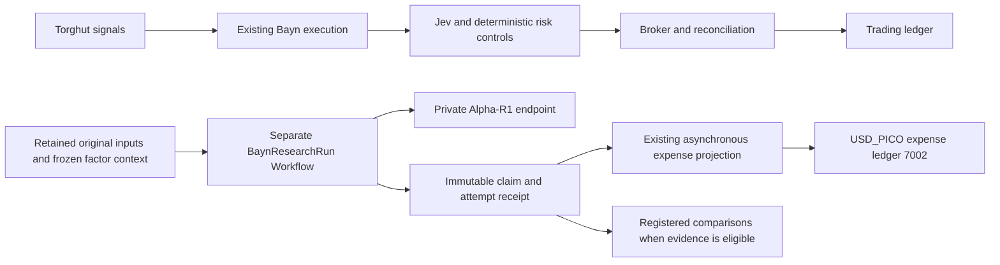

# Connect Alpha-R1 to Bayn research

Historical factor-screening design. Active research now follows the [Jev optimization contract](jev-optimization.md), with
a general instruction editor and native Jev evaluation. Alpha-R1 registrations remain immutable evidence and
cannot be submitted for new inference. The implementation and serving identities below describe the retired plan.

The independent research Workflow, streaming client, immutable attempt receipts, expense projection and operator
command are implemented. The isolated worker and approved credentials are enrolled in
[Bayn GitOps](../../argocd/applications/bayn/README.md#isolated-jev-instruction-research), using the existing Kargo release path.
No strategy has been admitted or economically qualified by this work.

The endpoint returns its verified model-lock identity and deployment-bound serving image with every inference
response. The worker compares all five serving-artifact fields with the approved run before consuming the stream,
retains them in the receipt, and verifies them again on replay and expense projection. A model alias alone is insufficient.

## Runtime

`BaynResearchRun` is a finite Restate Workflow keyed by the canonical run hash. It runs in a separate process and
deployment. It does not register execution or broker-observation handlers. The account controller adds no research
RPC, send acknowledgement, outbox wait, inference wait or expense-posting wait. Jev remains the trading model.

The server requires HMAC-SHA256 operator approval over the exact run hash. The separate, redacted approval key
never travels through Restate; the CLI signs the complete source, study, context, attempt, deadline/token budget
and cost basis. Changed or unsigned runs are rejected before `ctx.run`. A signed run can transmit once.
Invocations before its feature cutoff send no model request. This controls admission even though Restate's
shared internal ingress is reachable by other cluster workloads, without a per-run GitOps deployment.

The worker has one inference request in flight and a separate two-connection PostgreSQL pool. The existing model
admission controller bounds overlap across processes. Each attempt has a fixed deadline no later than 180 seconds
after its feature cutoff, including local waiting, HTTP transport and stream consumption. There is no automatic
model retry. Another explicit attempt changes the run hash and remains subject to the registered study's budget.

A PostgreSQL claim precedes transmission. A completed retained receipt replays without inference. A claim without a
receipt returns AMBIGUOUS without retransmission. Restate journaling alone cannot make an external inference call
exactly once. The CLI submits through the native Workflow API and attaches to an existing Workflow after HTTP 409.
It verifies the returned receipt against the caller's exact contract. It does not add an idempotency key to a Workflow.

The native model request streams usage and complete SSE termination. The worker checks the frozen model identity,
choice identity, normal finish, token totals and one unique allowed factor list. Truncation, malformed output,
expiry or transport ambiguity never becomes a successful result. The private receipt retains bounded original
response bytes, output, hashes, server request identity, TTFT, completion time, usage and outcome. Logs retain hashes
and timing. Prompts, outputs, credentials and provider error bodies are excluded from logs.

## Frozen evidence and costs

The run hash binds source revision, study and comparison-arm manifest hashes, original capture manifest hash,
feature cutoff, registration, attempt and deadline. It also binds the complete supported Alpha-R1 inference policy,
including checkpoint, serving image, tokenizer and chat-template revisions, temperature, top-p/top-k/min-p,
seed, penalties, reasoning mode, token budget, stops and selected-factor limit. Unknown request keys are rejected.
The server rejects a policy or source revision that differs from its deployed configuration.

The factor context binds formulas and implementation revisions, per-factor performance and matured-label cutoffs,
global market-memory bytes, exact semantic descriptions, the description producer manifest and preparation attempts.
Hashes must match the retained text. Evidence arriving after the feature cutoff is rejected. The upstream model
expects semantic descriptions; candidate IDs alone are insufficient. Description generation must use the existing
approved Flamingo with frozen prompts, input windows, revision and decoding settings. This change does not implement
that producer or manufacture missing historical descriptions.

Every comparison role needs its own registered manifest and attempt/time/cost budget, including Jev, direct Flamingo,
Alpha-R1, numeric selection and the immediate/delayed controls. Direct Flamingo selection and Flamingo description
generation are separate roles. Bind exact prompts, input transforms, thresholds, supported seeds or explicit
unsupported-seed status, output limits, tie-breaks, repeats and aggregation before evaluation. Opaque manifest hashes
in a development run are references, not independent verification that a study satisfied these requirements.

Local pricing uses an explicitly supplied, effective, source-backed reserved-capacity allocation in integer USD_PICO
per second. Completed calls freeze their allocated estimate in the immutable receipt. This is an infrastructure
allocation, not provider list price, measured request energy or an invoice. Missing bases, failed attempts and ambiguous
crash tails retain unknown cost. Token counts and power snapshots do not invent a dollar price. Preparation and shared
idle/energy/hardware allocations still need source evidence and conservation checks before an economic comparison.
An Alpha-R1 allocation alone is not complete research cost coverage.

The existing expense journal posts research allocations to ledger 7002 with separate study/account and run/transfer
identities. Existing Jev quote and transfer IDs are unchanged. Posting is exact and idempotent; a post-before-ack crash
can replay the same transfer. Unknown receipts stay unpriced. Known pending expenses cannot be starved behind them.
The existing accounting runtime owns posting through a separate two-connection pool. The research worker receives
no TigerBeetle or broker credential and cannot acknowledge its own expenses.

Worker metrics report heartbeat, inference duration, TTFT, completion tokens, outcomes, retained replays, unknown
expenses, ambiguous attempts and posting lag. Resource/request identities remain in logs and traces, not metric labels.
The existing Mimir rule source contains warning alerts for missing telemetry, repeated failed attempts and cost gaps.

## Current evidence and remaining acceptance

The live inventory at 2026-10-12 04:29 UTC found 224 chunks across 15 capture IDs and seven seals. One seal had
`INVALID_EVENT`; six had `PERSISTENCE_FAILED_OR_UNKNOWN`. Zero seals had an empty invalidation list. Unsealed chunks
cannot establish complete coverage. No eligible original session was available for the requested economic comparison.
The in-process recorder has been removed. The [market-data archive boundary](market-data-archive.md) governs its
replacement. Existing objects, credentials and bucket availability do not prove full original arrival, source
frontier or controller coverage. An independent Kafka archive cannot reconstruct when the trading worker received
a record or ran a controller pass.

Deliver the reviewed worker through main, immutable
publication, eligible Freight, the existing Kargo Stage, generated Kargo revision and Argo reconciliation. Verify an
actual factor-selection run, cancellation to zero model work, durable recovery, exact expense posting and matching
Tempo/Loki/Mimir evidence. Do not use a direct image bump or manual workload deployment. Recovery pauses only research.

Reuse an independently verified full session if one becomes available. Otherwise register a fresh calendar-verified
capture and measure bounded acquisition overhead before the session. Freeze chronology, train/validation/test windows,
label-overlap embargo, factor-to-Bayn horizon mapping, fees, slippage, stresses, budgets and rejection criteria before
outcomes. Include no-trade, abstention, error, holding and failed-attempt periods. Later archives cannot repair original
availability, missing candidate opportunities or immediate decision-feasibility evidence.

Run the existing [Jev incremental audit](jev-incremental-audit.md) first. Immediate momentum, the same unchanged
momentum delayed to Jev completion and Jev-filtered entries separate selection from delay under common sizing and
mechanical exits. Then compare independently evolving complete portfolios for Jev-only, Alpha-R1 selection, direct
Flamingo and one simple numeric selector under the same eligible data, risk and complete costs. Keep ticker/date
sensitivity and action-tape execution calibration diagnostic. Signal shuffling that changes holding or turnover is
not a valid unchanged-execution control. Keep every registered attempt and untouched session; never select the best repeat.

Measure entry and natural closure p95/p99 during actual sessions with research and Flamingo load, separating local
processing from broker acknowledgement/observation delays. Freeze sample requirements and uncertainty before the trial.
The proposed research guard remains at most 5% p95 and 10% p99 local latency increase, with zero additional missed
protective-close deadlines. These limits have not been measured. Sunday readiness cannot qualify trading latency.

A prospective shadow/paper candidate requires the existing qualification and authority path, full costs, untouched
outcomes, residual-position/close evidence and stress acceptance. Infrastructure health, a model answer, tests or a
reconciled expense transfer do not grant live capital or prove profitability. Missing evidence leaves the result UNKNOWN;
rejection is an acceptable completed experiment.

Primary references are the [Alpha-R1 model card](https://huggingface.co/FinStep/Alpha-R1),
[upstream pipeline](https://github.com/FinStep-AI/Alpha-R1),
[Restate durable steps](https://docs.restate.dev/develop/ts/durable-steps),
[Restate HTTP API](https://docs.restate.dev/services/invocation/http),
[execution-assumptions study](https://arxiv.org/html/2610.05077v1),
[KTD-Fin](https://arxiv.org/html/2605.28359v1) and
[Alpaca paper assumptions](https://docs.alpaca.markets/us/docs/paper-trading).
