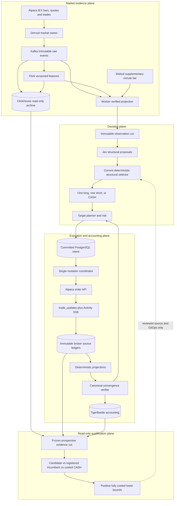

# Bayn architecture

## Boundary

Bayn is a single-writer intraday trading service. The execution path is account-neutral: sandbox and live accounts use
the same strategy, intent, risk, mutation, recovery, accounting, and reconciliation code. Broker environment and a
durable capital activation determine where an otherwise identical execution plan may run.

The active source selects `jev`, using `bayn.jev.protocol.v41`, numerical input v24 and pinned `jev-1.14.0`.
New entries are whole-share equities and may be long or short. A short requires a fresh broker account-configuration
read plus symbol-specific `shortable` and `easy_to_borrow` evidence; sale proceeds never increase its allocation
budget. Existing crypto positions retain risk-reducing exits, protection and recovery.
Historical strategy and decision schemas remain readable where persisted financial records require them; they cannot
start new cycles. Research control strategies are separate consumers, not additional active entry strategies.

The [November 8 system audit](system-audit-2026-11-08.md) contains the file and process inventory, source-linked request
flow, strategy arithmetic, transaction details, measured timing, live storage inventory, and ranked removal candidates.
It distinguishes observed excess from changes that still require performance or consumer evidence.

## Ownership

- The account-keyed Restate `BaynExecutionController` exclusively owns scheduling, serialization, durable retries,
  delayed ticks, and worker-version routing.
- Pure TypeScript owns market-data verification, the strategy decision, target planning, risk decisions, and cycle
  transitions.
- Effect owns bounded external I/O, typed failures, resource acquisition, logging, and tracing for one execution pass.
- PostgreSQL is the authoritative ledger for activations, cycles, decisions, intents, mutations, reconciliation, and
  the compact controller status projection.
- TigerBeetle is the authoritative accounting ledger for cash, fees, cost basis, and realized P&L.
- Dorvud owns the Alpaca IEX market WebSocket, publishes exact bars, quotes and trades to Kafka, and owns the separate
  account-scoped `trade_updates` WebSocket and Activity SSE connection. Broker events go directly to Restate and do
  not traverse the market-data bus.
- Dorvud/Flink consumes original Kafka bars and publishes versioned rolling features. Each execution worker owns a
  separate projection thread with scoped `@platformatic/kafka` consumers. Original arrivals are appended to the
  same PostgreSQL database as financial persistence, with immutable capture and ordered-prefix guards.
- ClickHouse is the read-only archive for raw events and complete feature revisions, including Kafka provenance.
- The broker read adapter supplies independent canonical account, order, position, fill, fee and borrow-eligibility
  observations through the restricted egress proxy. Only the mutation coordinator may submit or cancel orders.
- The public Bayn deployment serves read-only liveness, readiness, status, metrics, and traces. It does not schedule
  execution or own broker mutation authority.

## System shape and dependency rule

Dependencies move from immutable facts to pure decisions to committed intents to side effects, then back as new
immutable facts. No reducer calls the strategy, no strategy calls the broker, and no model response grants capital
authority. Research may read frozen evidence but cannot write execution state. Its only route into trading is a new
source-controlled protocol and authorization delivered through the normal review, Kargo and reconciliation gates.

Keep one owner for each mutable fact: Dorvud owns each provider connection, Restate owns account serialization,
PostgreSQL owns execution evidence, TigerBeetle owns posted money, and the selector owns the single trade-or-cash
choice. A second cursor, selector, mutation loop, accounting projection, or executable compatibility path is a defect,
not redundancy. Historical decoders may reproduce retained evidence but never start a current cycle.

## Intraday flow

1. Restate invokes one bounded `advanceExecutionOnce` pass for the canonical account-binding hash.
2. The pass reconciles persisted intents and broker state before considering new exposure. Any unknown mutation,
   discrepancy, stale observation, or identity drift blocks new orders.
3. During an eligible regular-market window, Bayn cuts its raw-plus-feature projection at one local observation.
   It requires exact feature-to-bar revision matches, the broker calendar, and fresh raw quotes and trades. A
   replacement worker rebuilds state through captured Kafka partition barriers within the five-minute startup budget.
4. Bayn constructs verified candidate state for the pinned Jev model, retains the complete inference batch, and
   derives a target portfolio or typed readiness from that evidence. Missing candidate features remain explicit
   exclusions. Current entry queries are candidate-only; benchmark requirements belong to the specific retained or
   research contract that requests them. Unavailable inference stays distinct from a valid
   no-trade result. Existing positions retain their sealed plan's protective stop and profit limit, plus holding-time
   and session-close deadlines; whole-share equity entries register the stop and target as native bracket children.
   PostgreSQL retains exact raw rows, selected feature payloads, actual receipt times, consumer epoch and sequence,
   transport positions, and snapshot hashes before execution. Archive and shadow modes retain their separate
   archive-availability evidence contracts; changing the deployed data mode requires reviewed GitOps.
5. The target planner derives whole-share deltas from the reconciled account and verified execution prices. The
   entry limit allows adverse price movement only within the bound risk policy's slippage allowance. The strategy
   decision, exact decision rows, planner input, target plan, allowance, risk decisions, and deterministic intent IDs
   are committed before broker I/O.
6. The mutation interpreter submits only committed, unexpired intents. Ambiguous outcomes remain unresolved until
   deterministic client-order-ID lookup and reconciliation recover them.
7. A filled or partially filled entry stays bound to its immutable cycle through position management and exit. A cycle
   completes only with terminal intents, later exact reconciliation and a flat account. After completion, and only
   before the entry cutoff, the standing mandate may create another distinct attempt from fresh signals. Re-entry
   requires the previous authority generation to be settled and replaced. Current-generation blocks and operator
   holds remain enforced. The v4 cycle identity and unique PostgreSQL authority slot bind increasing attempt ordinals.
8. The controller schedules exactly one successor tick. Restate delivery does not replace database idempotency or the
   persisted broker-mutation state machine.
9. Before the close, the same filled cycle enters close-only operation. Completion requires a flat account, no open orders or
   unresolved mutations, exact PostgreSQL/TigerBeetle reconciliation, and a persisted net-of-cost performance receipt.

## Active strategy

The submission window opens with the regular session. After its first completed minute and two-second decision
delay, Bayn evaluates up to 30 minutes of actual, possibly sparse history until five minutes before the close,
without an extra clock warmup. It supplies a deterministic candlestick image and source-bound context to Jev 1.14.
Bayn owns arithmetic, timing, sizing, risk and accounting.

One CHART call asks independent presence questions and Boxes for defended support, observed overhead resistance,
and a completed consolidation base. Code maps valid Boxes to original candle IDs. For eligible v41 equities it can
construct funded support-recovery and base-breakout long proposals plus resistance-rejection and base-breakdown short
proposals. The base excludes the newest candle, spans at least two completed candles, and cannot contain a source-time
gap. A long breakout bid must exceed its base high; a short breakdown ask must be below its base low.

The support proposal places its stop below the source support candle's low and its target below the observed
resistance candle's high, rounded to instrument precision. The long base proposal places its stop below the base low
and projects the base range upward. The short proposals mirror the price geometry without mirroring model
probabilities: their stop is above the observed resistance or base and their target is below entry. Source feasibility,
fee-inclusive funding, collateral and fresh borrow eligibility can reject a proposal before paid final judgment. Jev
does not generate prices or quantities.

The final JEV call asks whether each setup is confirmed and whether its stop invalidates the setup. Both judgments
must be at least 0.70. Within a symbol, selection ranks eligible proposals by the lower of those judgments, then lower
modeled stop loss, then stable proposal ID. These scores are not calibrated probabilities of profit. The parameters
and target construction have not established a profitable trading advantage.

Candidate pipelines run concurrently. Each CHART terminal and final-call handoff commits atomically before that
candidate's final JEV dispatch; another candidate can still be in CHART. Both calls share the original ten-second
evidence lifetime. There is no new budget at the handoff and no generic paid-call retry. Complete batch results and
receipts are retained before authorization. Entry risk binds a fresh execution quote for at most ten seconds from its
event time.

The strategy selects at most one equity position and caps its absolute weight at 20% of account equity. Allocation
bounds the actual weighted target by order, symbol, gross and net exposure limits and remaining daily buy-plus-sell turnover. It
reserves slippage and current exposure's liquidation notional before sizing the target. The planner and allocation
bounds use the same fixed-point weight precision.

Whole-share equity entries submit a LIMIT/DAY bracket that
binds the take-profit and stop before the parent fills; retained crypto and fractional inventory use individual protective
stop-limit orders. The sealed plan's profit limit, protective stop and 15-minute maximum holding period remain
enforced; protection and exit pricing are rechecked against fresh quotes, and an application exit cancels outstanding
protection and closes only reconciled residual inventory. Entries stop and forced flattening starts five minutes
before the actual session close. Close orders remain eligible until the bell; residual positions or unresolved
reconciliation remain incomplete. The protocol, universe, thresholds, feed contract, and execution model are
source-controlled and included in the image's verified behavior, parameter, and protocol hashes. See
[strategy protection](strategy-protection.md) for the exact plan, funding and protection contracts.

## Mutation and risk boundary

Mutation is capability-gated, not account-type-gated:

1. Static broker-access and capital-authority configuration set the maximum possible capability.
2. A current durable activation bound to source revision, image digest, strategy hashes, account reference, and risk
   policy must be realized before the runtime composes mutation capability.
3. PostgreSQL records `SUBMIT_STARTED`, the canonical request hash, deterministic client-order ID, and recovery delay
   before the first broker POST.
4. The coordinator rechecks authority, kill state, reconciliation, freshness, limits, and the half-open submission
   interval immediately before broker I/O.
5. Decoded broker rejections are terminal. Timeouts, malformed responses, server errors, interruption, or a post-send
   crash remain unknown and block new exposure.
6. Recovery performs deterministic read-by-client-order-ID. Broker POST and DELETE operations are never wrapped in a
   generic retry.

Long sells cannot exceed reconciled long inventory. A new short requires whole-share sizing, 150% initial collateral,
fresh easy-to-borrow eligibility and a cover bracket; sale proceeds do not become buying power. Symbol exposure, gross
and net exposure, turnover, loss, drawdown, open-order count, slippage, staleness, and cutoff limits fail closed.

## Target profitability architecture

The current selector ranks structurally supported proposals by model-judgment support and modeled stop loss. That is
deterministic, but it is not a proof of expected profit. Latency work can reduce stale fills and operating expense; it
cannot turn a negative strategy into an edge. A successor selector may ship only with the following architecture and
prospective qualification; these bullets do not describe a currently qualified edge:

1. Jev identifies and invalidates source-bound long and short structures. It does not rank expected returns.
2. A single versioned selector prices spread, slippage, broker and regulatory fees, borrow, inference, data and
   infrastructure costs without counting costs already reflected in broker equity twice.
3. The selector emits exactly one proposal or `CASH`. A quarantined setup is a post-selection cash veto; it never
   promotes a runner-up and therefore cannot create an unregistered policy through fallback behavior.
4. Risk and capital authority may only reduce the selected exposure. They cannot substitute another symbol or side.
5. Outcomes append to evidence and accounting. They do not tune the running policy. Any learned change becomes a new
   preregistered protocol evaluated prospectively.

One session's primary economic outcome is
`close broker equity - open broker equity - external funding - costs not yet recognized in broker equity`. The
candidate is compared on matched prospective sessions against `INCUMBENT_AT_REGISTRATION` and `COSTED_CASH`.
`LEGACY_PRE_JEV_CONTROL` remains historical context only. Independent virtual shadows may discover hypotheses, but
they cannot qualify PAPER because they do not reproduce the account, rejection, borrow, queueing and capital path.

Qualification requires positive lower confidence bounds for candidate absolute net return, candidate minus the
registered incumbent, and candidate minus costed cash. Those bounds are reported separately for rising and falling
market regimes and for long and short opportunities, with the protocol, universe, cost model, calendar, sample size,
stopping rule and multiplicity policy frozen before the first observation. Failure of any bound means `CASH`/OBSERVE,
not a threshold retune. Formal proofs cover determinism, fencing and accounting conservation; only prospective broker
outcomes can establish edge.

## Effect composition

Effect is used at capability and failure boundaries, not as a wrapper around pure calculations:

- strategy calculations, hashing, market-data validation, target planning, risk rules, and state transitions are pure
  immutable functions;
- database, Kafka, ClickHouse, TigerBeetle, broker, telemetry, and HTTP resources are scoped Effect services;
- the execution worker owns one process-scoped `ManagedRuntime`, while each Restate handler runs one bounded pass;
- typed domain blockers return durable outcomes and continue the reconciliation cadence; transient infrastructure
  failures use bounded Restate retries; and
- credentials, plaintext account identity, raw broker payloads, and strategy data never enter logs, metrics, traces, or
  public status.

Do not introduce repositories, registries, plugins, events, or dependency-injection wrappers for pure values. Add a
service only for a real acquired capability, external I/O boundary, or typed lifecycle.

## Runtime state and HTTP

Internal operational states are `STARTING`, `READY`, `DEGRADED`, and `FAILED`. The health projection independently
tracks PostgreSQL, Signal/ClickHouse, TigerBeetle, cycle state, and the cycle runner as `UNKNOWN`, `AVAILABLE`, or
`UNAVAILABLE`.

`GET /readyz` is ready only when all of the following are true:

- operational status is `READY` and the health observation is within its freshness lease;
- no capital activation is pending;
- the cycle condition is neither `UNKNOWN`, `STALLED`, nor `FAILED`;
- the most recent controller pass is not a failure;
- every required dependency is `AVAILABLE`; and
- when a broker is configured, its account binding and read capability are both verified.

`GET /v1/status` reports operational health, dependencies, data state, accounting and economics, the current or latest
cycle, controller loop and durable Restate projection, capital activation, redacted broker state, effective authority,
verified build identity, and the current blocker. It does not expose the removed evaluation or qualification
projections. `authority.brokerOrders` and `authority.capitalPromotion` become true only after the exact durable capital
activation is realized; configuration alone is not authority.

`GET /livez` proves only that the HTTP process is alive. A ready status pod, a healthy Restate deployment, or an Argo
`Synced/Healthy` result alone does not prove that a trading decision, broker order, fill, or profit occurred.

## Delivery and recovery

Normal delivery is immutable and GitOps-only:

1. merge reviewed source to `main`;
2. build and publish the exact multi-architecture image;
3. let the Bayn Kargo Warehouse and authorized Stage select eligible Freight and write the generated `kargo/<stage>`
   deployment commit, preserving source, image, strategy, activation, and risk identity checks;
4. let Argo reconcile that exact generated commit for status, execution, research, and activation resources; and
5. verify the exact source and image live before accepting controller or broker evidence. Follow the
   [release contract](../release-automation.md); a manual digest bump does not replace promotion.

The public status Deployment may surge because it has no execution authority. Multiple execution-worker replicas are
safe because Restate serializes the account-keyed virtual object and PostgreSQL enforces the writer fence for every
trading-state transaction. Intents and deterministic client-order IDs remain the protection across retries, worker
replacement, and ambiguous broker responses.

Rollback must deactivate the current controller epoch and prove the writer fence clear before activating another
source/image identity. Direct deployment and manual broker orders are not valid rollout or trading proof.

## Completion evidence

Historical archive replay defaults to requiring production-reader receipts for every used row by the simulated
observation time. Missing or late candidate receipts become candidate-local, zero-weight exclusions before the shared
core ranks the remaining symbols; the report binds those exclusions separately from the unchanged archive manifest.
Missing benchmark/pricing receipts and an entirely unavailable candidate universe remain incomplete. Malformed,
conflicting, or unrelated receipt evidence still fails the whole observation. Source receipt timestamps cannot stand
in for Kafka/Flink/ClickHouse availability. Explicit `source-receipt-assumption` research remains possible but is labeled `UNPROVEN`.
Receipts establish conservative observed row-availability bounds, not earliest visibility, a simultaneous historical
snapshot, the original worker's uptime, or actual execution. They cannot repair missing delivery evidence from before
recording was deployed. See the service README for report v3 and read-only receipt configuration.

Operational rollout requires the exact reviewed source/image live, fresh controller ticks after worker replacement,
fresh status projections, exact reconciliation, and zero unresolved mutations. Autonomous trading requires additional
natural-session evidence: a verified decision, deterministic broker intents, broker-confirmed fills when the strategy
trades, close/flat completion, exact accounting, all costs, and realized return. A valid `NO_TRADE` is reported as such;
profit is never inferred from infrastructure health.
