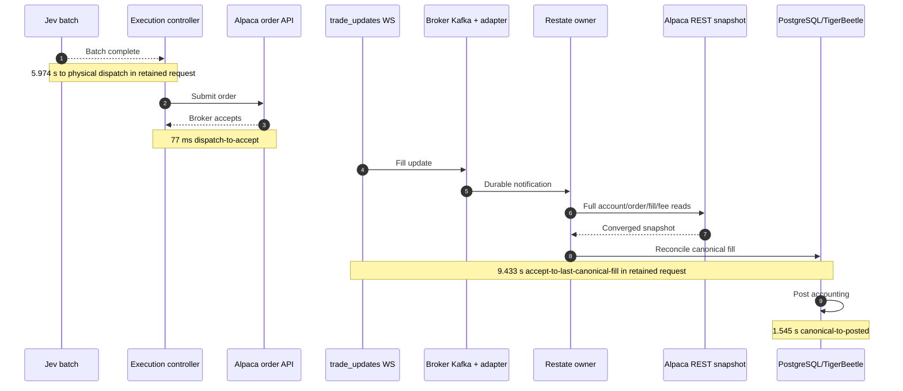
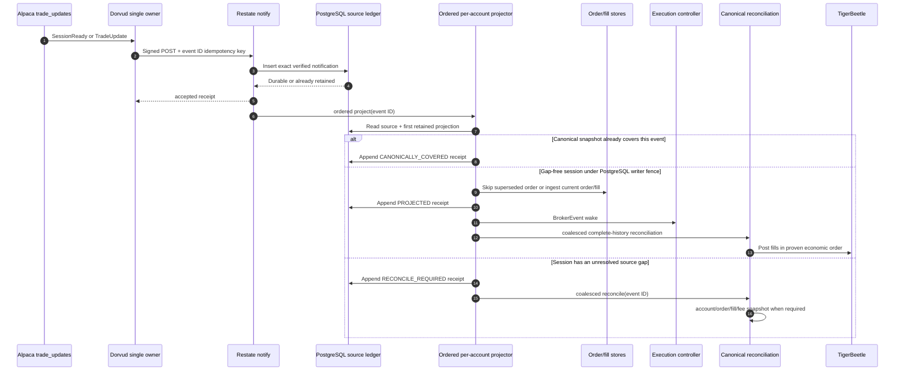
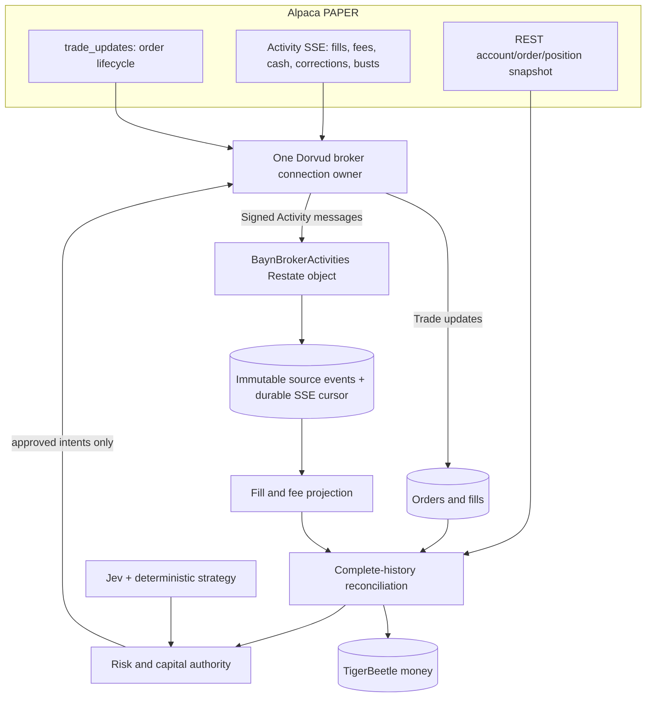

# Bayn durable broker event architecture

The source implements direct trade-update projection and a single durable Activity SSE cursor.

## Decision

Bayn uses one broker connection owner and one durable financial source ledger. Provider streams append immutable
facts; deterministic reducers project those facts into order, fill, cash and accounting state. Restate owns durable
per-account orchestration. PostgreSQL owns append-only source and projection evidence. TigerBeetle owns posted money.
REST snapshots verify convergence and repair gaps; they are not the normal fill critical path. Strategy inference,
including Jev, produces proposals only. Risk, reconciliation and accounting remain independent authorities.

Kafka and Flink remain correct for fan-out market data and feature computation. They are unnecessary serialization
and failure domains for the single-account broker lifecycle lane, so the broker-only adapter and every producer and
consumer are deleted. The inert topic is retained only across the live cutover because the Kafka application tracks
`main` while Bayn tracks `kargo/bayn`; deleting it before promotion would break the incumbent path. The immediate
post-rollout cleanup deletes the topic after the direct path is proven. This distinction keeps each transport aligned
with its workload instead of imposing one bus everywhere.

## Measured pre-change request flow

The November 20 PAPER investigation measured broker capture at approximately 4.32 s p50 / 9.54 s p95, broker
publication at 321 ms p50 / 489 ms p95, and reconciliation persistence at 770 ms p50 / 1.50 s p95. One retained
request illustrates the serial critical path below. These seconds are real because complete provider reads and
reconciliation were on the path; they were not network transmission time.

The 5.974 s pre-dispatch interval and the 9.433 s fill-canonicalization interval are both economically relevant, but
they have different owners. Removing the broker adapter cannot fix Jev/scheduling time. Immediate source projection
can remove the full snapshot from the ordinary fill path. The retained example totals about 17.0 s across the labeled
segments; session distributions, not this single request, determine the release result.

## Implemented direct path

The direct path has four independent replay boundaries:

1. Dorvud retries transient HTTP failures with the same event ID.
2. Restate retains ingress and continuation idempotency for seven days.
3. PostgreSQL retains the exact source and first projection receipt indefinitely.
4. Broker-event and TigerBeetle identities make a lost response safe to retry.

Dorvud becomes ready only when the receipt names the current source revision and
`bayn.broker-source-projection.v1`. An acceptance from the retired identity-only handler fails the session and creates
a new session boundary on reconnect, so an old cached acknowledgement cannot masquerade as the new persistence
contract. Retaining a new source event and revoking the readable broker-observation generation share one PostgreSQL
transaction. Restate may route the new shared handler before exclusive observation ownership rotates, but no
predecessor revision can keep admitting its earlier snapshot after the acknowledgement. Migration keeps an isolated
append-only legacy receipt sink solely while Restate drains accepted old-worker
invocations; no current code uses it. Post-cutover cleanup merges any late identities and deletes that sink together
with the inert broker topic.

The same overlap applies to order evidence. Migration 206 adds the required full-precision provider version, but an
already prepared predecessor insert does not name that column. A temporary `orders` admission trigger derives the
canonical version from the immutable `order:<broker-order-id>:<updated-at>` source identity under the account writer
lock. It rejects older versions, timestamp reuse with another identity, mismatched explicit values and malformed
source identities. Thus a predecessor can append a genuinely newer observation without a `NOT NULL` failure, but it
cannot bypass the new monotonic-current-state rule. The post-cutover cleanup removes this predecessor insert branch
only after the old revision and prepared statements have drained; current writers already supply the column directly.

Migration assigns every identity-only receipt from the retired Kafka path an immutable `LEGACY_RECEIPT`
reconciliation decision. A redelivery can therefore request canonical recovery without entering the projector path
that requires the newly retained raw notification.

Unsupported frames, missing intent linkage and deterministic store conflicts never invent state. They append a
`RECONCILE_REQUIRED` receipt and leave the canonical safety lane authoritative. Source-to-projection lag and outcome
are exported without account or event IDs through `bayn_broker_source_projection_lag_seconds` and
`bayn_broker_source_projection_total`. A database-backed pending count and oldest age expose a stalled first projection,
which completion histograms cannot see. That backlog spans retained source revisions, and an explicit observation
success gauge makes database sampling failure visible instead of preserving a stale zero. The projector is a separate
exclusive Restate object keyed by account with a projection-only PostgreSQL store: source delivery stays ordered, but
a multi-second canonical capture cannot block this queue. After reconnect, the fast path
remains closed after publication and opens only when complete-history persistence is exact, accounting is exact, and
completion advances the capture's financial-reconciliation fence past that session's `SessionReady` event. Completion
is bound to the source revision, observation generation and snapshot hash, so concurrent ingress makes a stale
completion a no-op.
Canonical coverage is checked inside the same PostgreSQL writer fence as order/fill ingestion, so reconciliation and
the stream cannot race to make a delayed order state newest. Order current state is selected by Alpaca's full
nine-digit provider `updated_at`, retained as `orders.broker_updated_at`; local arrival order and PostgreSQL's
lower-precision timestamp conversion never decide freshness. A delayed stream order reuses the receipt for the newer
durable provider version instead of appending a regressive state. A complete-history snapshot selects the newest
provider version per broker order and fails closed if that version is older than the one already retained. Reuse of
one provider timestamp with a different source identity is a conflict. Alpaca REST history can render the same order
with a microsecond `updated_at` while the stream retains additional nanoseconds. That lower-precision observation
reuses the retained stream receipt only when its raw timestamp is a strict prefix of the retained version and hashing
the complete order state at the retained raw timestamp reproduces the retained content hash. A different state or a
genuinely older microsecond remains a conflict. Any trade update arriving
before the session proof, or any later invalid, unsupported, unbound or conflicting trade update, poisons only that
session's fast lane; all subsequent updates in that session take canonical reconciliation. A new gap-free
`SessionReady` session can re-enter the fast path only after its own boundary is financially reconciled.

Alpaca can emit zero-fill `held` or `accepted` observations for a protective child before the submit response or
canonical capture establishes its parent. These recognized lifecycle observations may defer projection until the
original notification time plus the configured operation timeout. The ordered projector requests canonical
reconciliation before waiting and releases the PostgreSQL writer fence between attempts. It writes no projection
receipt while that bounded proof is pending. Canonical coverage ends the wait without replaying the event; otherwise
the exact account, broker order, client order, inherited intent, root parent and immutable protection terms must
match retained canonical evidence. Group metadata is only an eligibility check, never an identity lookup. The
canonical child association proves identity independently of financial coverage: capture claim time precedes the
provider's observation time, so comparing those clocks would incorrectly reject the newest valid association.
Unbound expiry and invalid content retain the existing session-gap behavior, and new session boundaries still
require completed financial reconciliation. No historical gap receipt is removed or reclassified.

The WebSocket projector never posts money. A valid later fill can arrive before an unseen valid predecessor, so
serialized delivery alone cannot prove an economic prefix. The projector retains order/fill evidence and wakes the
controller immediately, while complete-history reconciliation remains the only TigerBeetle writer. Activity SSE can
move accounting onto the streaming path only after its replay cursor and correction chain establish that prefix.

## Durable Activity SSE path

Alpaca's current [Activity SSE guide](https://docs.alpaca.markets/us/docs/activity-sse) defines the financial-state
replication contract: persist the last `event_id` ULID, reconnect with `since_id`, deduplicate with `ref_id`, and reverse
the activity named by `previous_id` before applying a correction or bust. The Trading API now exposes the
[same endpoint](https://docs.alpaca.markets/us/reference/subscribetoactivitiessse). The lower-latency
[`trade_updates` WebSocket](https://docs.alpaca.markets/us/docs/websocket-streaming) remains necessary for non-financial
order lifecycle events.

The feed presents the exact provider payload, publication ULID, and `ref_id` and `previous_id` identities. The
account-keyed Restate handler acknowledges after PostgreSQL commits the source, projection and cursor. Inclusive
redelivery returns the retained disposition. An activity referencing an earlier fill or fee records a replacement
or reversal in the projection. Canonical reconciliation owns the posted accounting entries.

Initial catchup proves a provider publication interval. Its count and hash must match the durable events in that
interval. A live heartbeat confirms session liveness after coverage completes. A contradictory publication or
conflicting source payload invalidates broker observations and blocks ordinary submission. Canonical readback
continues for reconciliation and investigation. A missing or expired Activity view selects canonical REST recovery.

## Profitability boundary

Architecture can remove latency, duplicate infrastructure and stale-state loss, but it cannot prove market edge. The
November 16–20 retained cohort lost money while inference latency improved, so "faster" is not itself an alpha thesis.
The system stays economically honest by keeping three ledgers separate:

- execution economics: realized gross P&L, spread, slippage, borrow constraints and broker fees;
- operating economics: inference, data and infrastructure expenses with no fabricated zero costs;
- research evidence: prospective, preregistered candidate-versus-incumbent and paired long/short results.

A profitability change advances only when the exact candidate is positive after all three cost surfaces, beats the
incumbent on a prospective paired sample, and retains lower-bound evidence across rising and falling regimes. Jev is
not removed to manufacture that result. Stream latency is a measured covariate and execution-quality lever, not a
substitute for the qualification gate.

## Release proof

The release is complete only after reviewed merge, immutable three-image publication, Kargo Freight and Stage,
generated `kargo/bayn`, Argo reconciliation, exact running images, and a real PAPER lifecycle. Acceptance compares the
same boundaries before and after:

- Dorvud receipt to immutable source row;
- source `received_at` to first projection `completed_at`;
- fill source time to accounting receipt;
- submission start to broker acceptance and first/last fill;
- duplicate/reconnect delivery to one source, projection and accounting identity;
- full canonical convergence after the immediate projection.

Only observed p50/p95/counts and failure denominators support a performance claim. A healthy pod, green test, empty
session or architectural estimate does not.
