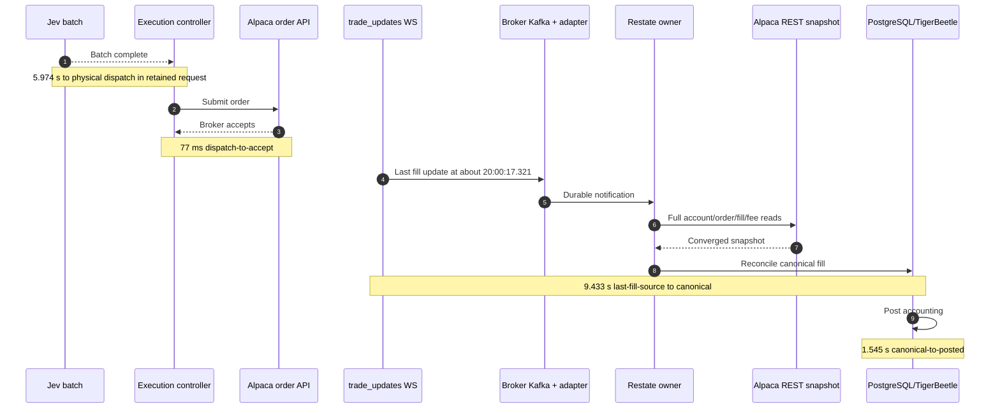
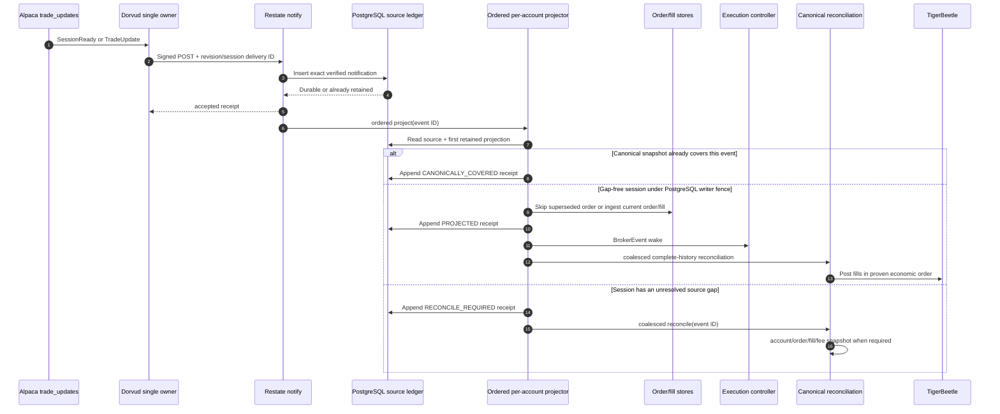
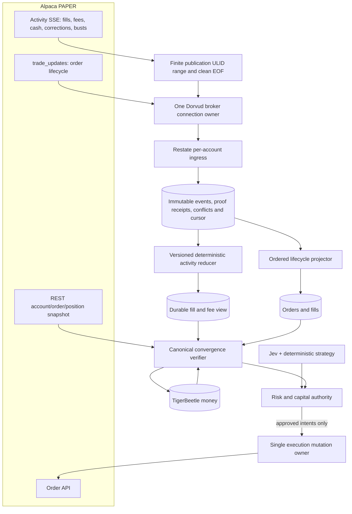
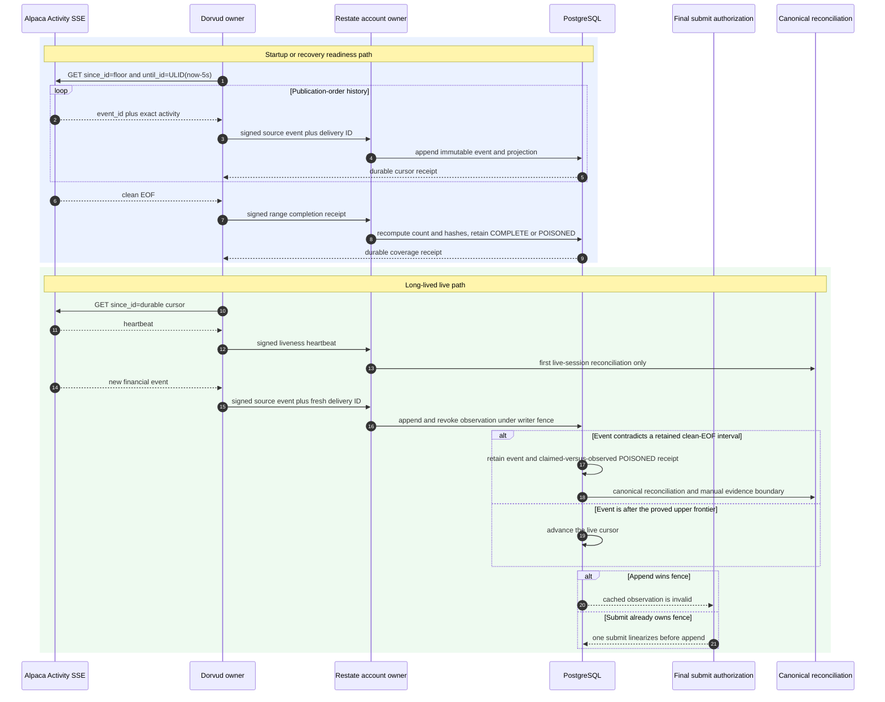

# Bayn durable broker event architecture

Status: direct trade-update projection and durable Activity SSE ownership are implemented in source; live release
acceptance remains required before any latency, request-count, or reliability improvement is claimed.

## Decision

Bayn uses one broker connection owner and one durable financial source ledger. Provider streams append immutable
facts; deterministic reducers project those facts into order, fill, cash and accounting state. Restate owns durable
per-account orchestration. PostgreSQL owns append-only source and projection evidence. TigerBeetle owns posted money.
REST snapshots verify convergence and repair gaps; they are not the normal fill critical path. Strategy inference,
including Jev, produces proposals only. Risk, reconciliation and accounting remain independent authorities.

Kafka and Flink remain correct for fan-out market data and feature computation. They are unnecessary serialization
and failure domains for the single-account broker lifecycle lane, so the broker-only adapter and every producer and
consumer are deleted. The inert topic is retained only across the live cutover because the Kafka application tracks
`main` while Bayn tracks `kargo/bayn`; deleting it before promotion would break the incumbent path. The immediate
post-rollout cleanup deletes the topic after the direct path is proven. This distinction keeps each transport aligned
with its workload instead of imposing one bus everywhere.

## Measured pre-change request flow

The November 20 PAPER investigation measured broker capture at approximately 4.32 s p50 / 9.54 s p95, broker
publication at 321 ms p50 / 489 ms p95, and reconciliation persistence at 770 ms p50 / 1.50 s p95. One retained
request illustrates the boundary timestamps below. These seconds are real because complete provider reads and
reconciliation were on the path; they were not network transmission time. The single request is not a percentile.

The retained timestamps are `20:00:12.147` for durable `SUBMIT_STARTED`, `20:00:12.331` for physical dispatch,
`20:00:12.408` for broker acceptance, `20:00:26.754` for the last canonical fill, and `20:00:28.299` for posting. Thus
submit-start to dispatch is 184 ms, dispatch to acceptance is 77 ms, and acceptance to canonicalization is 14.346 s.
The labeled 9.433 s is the nested last-fill-source-to-canonical segment, not acceptance-to-canonical. The intervals
must not be added as if they were adjacent. Jev-batch-to-dispatch is on the order-acceptance critical path;
fill-source-to-canonical and canonical-to-posted are on completion and realized-economics critical paths. Removing the
broker adapter cannot fix Jev or scheduling time. Immediate source projection can remove the full snapshot from the
ordinary fill path. Session distributions, not this request, determine the release result.

## Implemented direct path

The direct path has four independent replay boundaries:

1. Dorvud retries one delivery with the same revision-, credential-, session- and handler-bound delivery ID.
2. Restate retains ingress and continuation idempotency for seven days.
3. PostgreSQL retains the exact source and first projection receipt indefinitely.
4. Broker-event and TigerBeetle identities make a lost response safe to retry.

Dorvud becomes ready only when the receipt names the current source revision and
`bayn.broker-source-projection.v1`. Activity receipts independently require
`bayn.broker-activity-projection.v2`. An acceptance from the retired identity-only handler fails the session and creates
a new session boundary on reconnect, so an old cached acknowledgement cannot masquerade as the new persistence
contract. Retaining a new source event and revoking the readable broker-observation generation share one PostgreSQL
transaction. Restate may route the new shared handler before exclusive observation ownership rotates, but no
predecessor revision can keep admitting its earlier snapshot after the acknowledgement. Migration keeps an isolated
append-only legacy receipt sink solely while Restate drains accepted old-worker
invocations; no current code uses it. Post-cutover cleanup merges any late identities and deletes that sink together
with the inert broker topic.

The same overlap applies to order evidence. Migration 206 adds the required full-precision provider version, but an
already prepared predecessor insert does not name that column. A temporary `orders` admission trigger derives the
canonical version from the immutable `order:<broker-order-id>:<updated-at>` source identity under the account writer
lock. It rejects older versions, timestamp reuse with another identity, mismatched explicit values and malformed
source identities. Thus a predecessor can append a genuinely newer observation without a `NOT NULL` failure, but it
cannot bypass the new monotonic-current-state rule. The post-cutover cleanup removes this predecessor insert branch
only after the old revision and prepared statements have drained; current writers already supply the column directly.

Migration assigns every identity-only receipt from the retired Kafka path an immutable `LEGACY_RECEIPT`
reconciliation decision. A redelivery can therefore request canonical recovery without entering the projector path
that requires the newly retained raw notification.

Unsupported frames, missing intent linkage and deterministic store conflicts never invent state. They append a
`RECONCILE_REQUIRED` receipt and leave the canonical safety lane authoritative. Source-to-projection lag and outcome
are exported without account or event IDs through `bayn_broker_source_projection_lag_seconds` and
`bayn_broker_source_projection_total`. A database-backed pending count and oldest age expose a stalled first projection,
which completion histograms cannot see. That backlog spans retained source revisions, and an explicit observation
success gauge makes database sampling failure visible instead of preserving a stale zero. The projector is a separate
exclusive Restate object keyed by account with a projection-only PostgreSQL store: source delivery stays ordered, but
a multi-second canonical capture cannot block this queue. After reconnect, the fast path
remains closed after publication and opens only when complete-history persistence is exact, accounting is exact, and
completion advances the capture's financial-reconciliation fence past that session's `SessionReady` event. Completion
is bound to the source revision, observation generation and snapshot hash, so concurrent ingress makes a stale
completion a no-op.
Canonical coverage is checked inside the same PostgreSQL writer fence as order/fill ingestion, so reconciliation and
the stream cannot race to make a delayed order state newest. Order current state is selected by Alpaca's full
nine-digit provider `updated_at`, retained as `orders.broker_updated_at`; local arrival order and PostgreSQL's
lower-precision timestamp conversion never decide freshness. A delayed stream order reuses the receipt for the newer
durable provider version instead of appending a regressive state. A complete-history snapshot selects the newest
provider version per broker order and fails closed if that version is older than the one already retained. Reuse of
one provider timestamp with a different source identity is a conflict. Any trade update arriving
before the session proof, or any later invalid, unsupported, unbound or conflicting trade update, poisons only that
session's fast lane; all subsequent updates in that session take canonical reconciliation. A new gap-free
`SessionReady` session can re-enter the fast path only after its own boundary is financially reconciled.

The WebSocket projector never posts money. A valid later fill can arrive before an unseen valid predecessor, so
serialized delivery alone cannot prove an economic prefix. The projector retains order/fill evidence and wakes the
controller immediately, while complete-history reconciliation remains the only TigerBeetle writer. Activity SSE can
move accounting onto the streaming path only after its replay cursor and correction chain establish that prefix.

## Durable financial-state path

Alpaca's current [Activity SSE guide](https://docs.alpaca.markets/us/docs/activity-sse) defines the financial-state
replication contract: persist the last `event_id` ULID, reconnect with `since_id`, deduplicate with `ref_id`, and reverse
the activity named by `previous_id` before applying a correction or bust. The Trading API now exposes the
[same endpoint](https://docs.alpaca.markets/us/reference/subscribetoactivitiessse). The lower-latency
[`trade_updates` WebSocket](https://docs.alpaca.markets/us/docs/websocket-streaming) remains necessary for non-financial
order lifecycle events. The provider only exposes activities booked after February 11, 2026. Bayn therefore refuses
to declare a complete prefix for accounts created before February 12, 2026 UTC; those accounts require a separately
verified opening snapshot or another complete source before this path can be enabled.

The source hard migration is explicit:

- the single Dorvud process owns Activity SSE beside `trade_updates`;
- the first session performs a finite `since_id`/`until_id` publication-order replay from the provider history floor;
  PostgreSQL makes the prefix usable only after clean EOF and independent recomputation of its event count, prefix hash,
  range-request hash and completion hash;
- account creation must be inside the provider's complete-history window, otherwise the owner fails before reading or
  retaining a cursor;
- PostgreSQL persists the last retained ULID and later live owners resume with `since_id` (or the proved upper frontier
  for an empty prefix);
- immutable rows preserve exact Activity JSON text, its hash, `ref_id`, and `previous_id` before projection;
- correction and bust chains reverse one active predecessor through append-only projection rows;
- historical replay appends without scheduling one reconciliation per event; the first acknowledged live heartbeat
  activates one coalesced canonical capture, while later live events retain event-driven invalidation;
- documented non-fill/non-fee activities are retained as canonical-only evidence and advance the cursor without
  pretending to project cash or positions; independent REST account and position reads remain authoritative for them;
- the complete cursor versions the fill cut, while a separate hash of active fee source identities versions REST fee
  verification; fills, heartbeats and canonical-only journals therefore cannot trigger an unchanged full fee-history
  scan, while every fee correction or bust invalidates that verification;
- catch-up completion and live liveness are separate signed messages, so a heartbeat cannot certify history;
- signed live heartbeats prevent a disconnected prefix from appearing current;
- provider reuse of one publication ULID with different authenticated content is retained as immutable conflict
  evidence, revokes the observation generation, and permanently closes financial completeness;
- a later publication whose ULID falls inside a retained clean-EOF range is retained, but its independently recomputed
  count, prefix and completion hashes become an immutable `LATE_PUBLICATION` conflict; coverage and liveness close under
  the writer fence, canonical reconciliation runs, and final submission remains blocked on the poisoned receipt;
- Activity append and final order authorization acquire the same PostgreSQL writer fence, so a fetched observation is
  either revalidated after the append or the append commits after that one submit linearization point;
- an unknown activity, a cross-view correction, or a failed invariant closes the fill/fee projection and uses canonical REST
  reconciliation;
- the replica-local Activity SSE implementation and its process-local replay state are deleted.

The finite range is a startup and recovery readiness path, not a per-order request. Heartbeats are not on the ordinary
order or fill critical path after readiness, but their freshness gates use of the streaming projection. The shared
writer fence is on the critical path only when an Activity append and final broker submit overlap. That contention is
intentional: eliminating it would reintroduce the stale-observation race. Its wait time must be measured separately
from provider capture, Jev inference, broker acceptance and canonical accounting.

The next boundary is live equivalence: exact images, migration, finite catch-up, source rows, cursor replay, heartbeats,
correction/bust
projection, stale-stream fallback, canonical convergence, and restart recovery must all be observed on PAPER. Until
that deployment proof exists, no reduction in Activity SSE connection count or provider REST calls is claimed. Moving
TigerBeetle posting onto the reducer is a separate change and remains prohibited until the durable prefix is proven
against independent canonical snapshots.

## Profitability boundary

Architecture can remove latency, duplicate infrastructure and stale-state loss, but it cannot prove market edge. The
November 16–20 retained cohort lost money while inference latency improved, so "faster" is not itself an alpha thesis.
The system stays economically honest by keeping three ledgers separate:

- execution economics: realized gross P&L, spread, slippage, borrow constraints and broker fees;
- operating economics: inference, data and infrastructure expenses with no fabricated zero costs;
- research evidence: prospective, preregistered candidate-versus-incumbent and paired long/short results.

A profitability change advances only when the exact candidate is positive after all three cost surfaces, beats the
incumbent on a prospective paired sample, and retains lower-bound evidence across rising and falling regimes. Jev is
not removed to manufacture that result. Stream latency is a measured covariate and execution-quality lever, not a
substitute for the qualification gate.

## Release proof

The release is complete only after reviewed merge, immutable three-image publication, Kargo Freight and Stage,
generated `kargo/bayn`, Argo reconciliation, exact running images, and a real PAPER lifecycle. Acceptance compares the
same boundaries before and after:

- Dorvud receipt to immutable source row;
- source `received_at` to first projection `completed_at`;
- fill source time to accounting receipt;
- submission start to broker acceptance and first/last fill;
- duplicate/reconnect delivery to one source, projection and accounting identity;
- full canonical convergence after the immediate projection.

Only observed p50/p95/counts and failure denominators support a performance claim. A healthy pod, green test, empty
session or architectural estimate does not.
