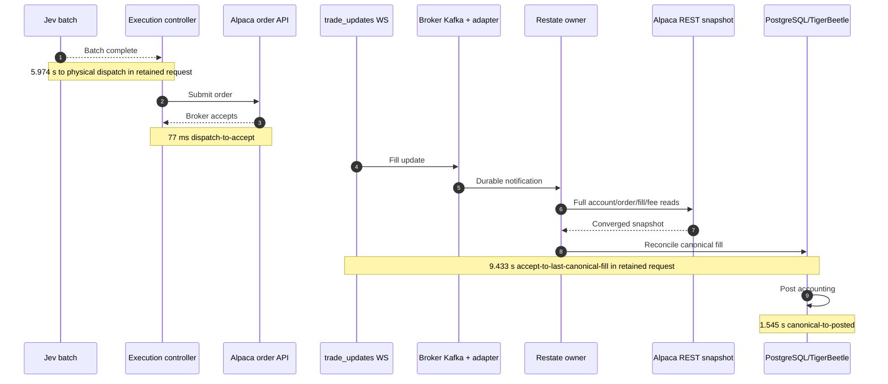
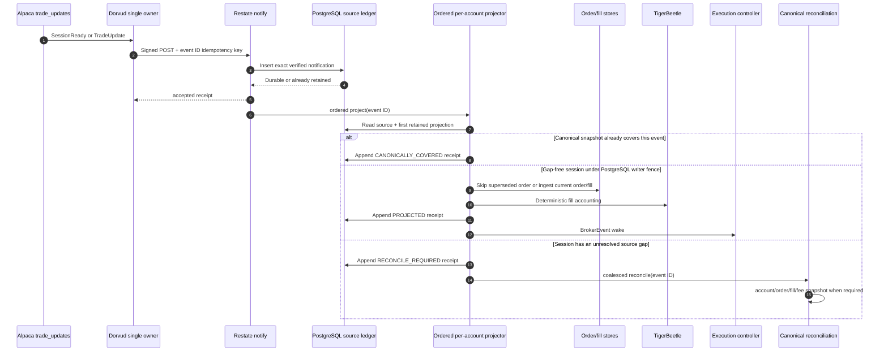
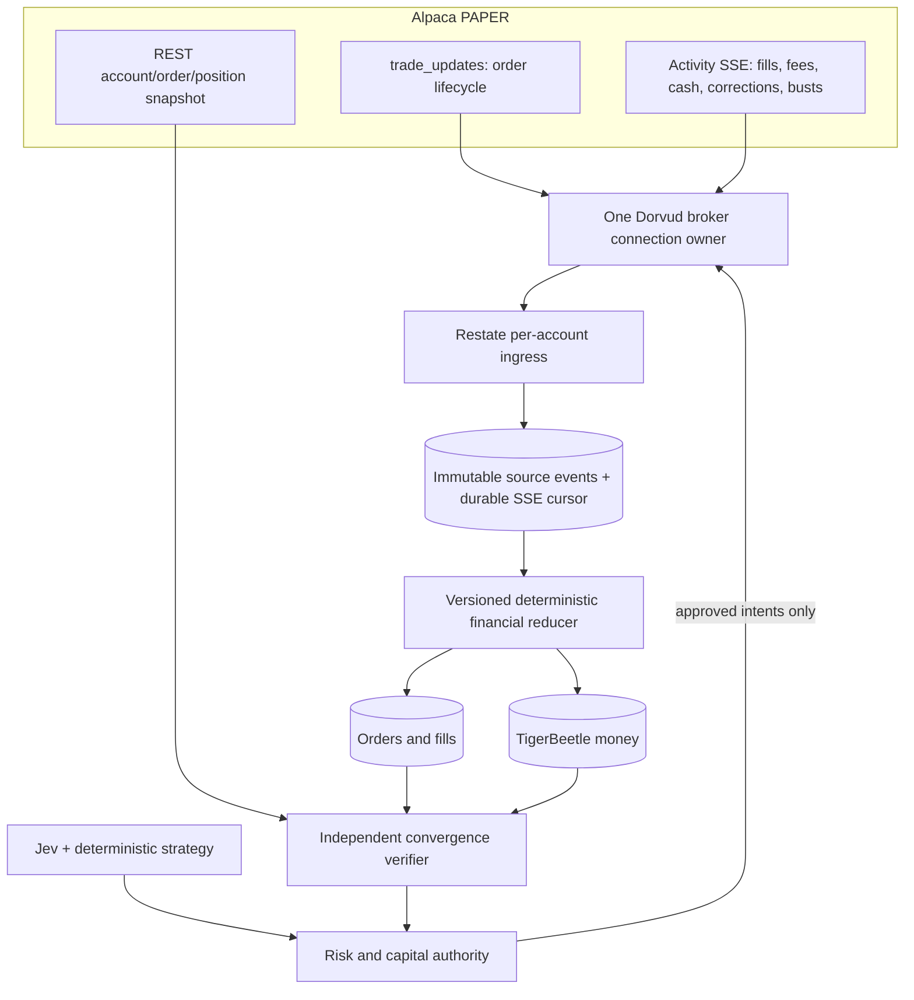

# Bayn durable broker event architecture

Status: direct trade-update projection implemented; Activity SSE ownership migration remains required.

## Decision

Bayn uses one broker connection owner and one durable financial source ledger. Provider streams append immutable
facts; deterministic reducers project those facts into order, fill, cash and accounting state. Restate owns durable
per-account orchestration. PostgreSQL owns append-only source and projection evidence. TigerBeetle owns posted money.
REST snapshots verify convergence and repair gaps; they are not the normal fill critical path. Strategy inference,
including Jev, produces proposals only. Risk, reconciliation and accounting remain independent authorities.

Kafka and Flink remain correct for fan-out market data and feature computation. They are unnecessary serialization
and failure domains for the single-account broker lifecycle lane, so the broker-only adapter and every producer and
consumer are deleted. The inert topic is retained only across the live cutover because the Kafka application tracks
`main` while Bayn tracks `kargo/bayn`; deleting it before promotion would break the incumbent path. The immediate
post-rollout cleanup deletes the topic after the direct path is proven. This distinction keeps each transport aligned
with its workload instead of imposing one bus everywhere.

## Measured pre-change request flow

The November 20 PAPER investigation measured broker capture at approximately 4.32 s p50 / 9.54 s p95, broker
publication at 321 ms p50 / 489 ms p95, and reconciliation persistence at 770 ms p50 / 1.50 s p95. One retained
request illustrates the serial critical path below. These seconds are real because complete provider reads and
reconciliation were on the path; they were not network transmission time.

The 5.974 s pre-dispatch interval and the 9.433 s fill-canonicalization interval are both economically relevant, but
they have different owners. Removing the broker adapter cannot fix Jev/scheduling time. Immediate source projection
can remove the full snapshot from the ordinary fill path. The retained example totals about 17.0 s across the labeled
segments; session distributions, not this single request, determine the release result.

## Implemented direct path

The direct path has four independent replay boundaries:

1. Dorvud retries transient HTTP failures with the same event ID.
2. Restate retains ingress and continuation idempotency for seven days.
3. PostgreSQL retains the exact source and first projection receipt indefinitely.
4. Broker-event and TigerBeetle identities make a lost response safe to retry.

Migration assigns every identity-only receipt from the retired Kafka path an immutable `LEGACY_RECEIPT`
reconciliation decision. A redelivery can therefore request canonical recovery without entering the projector path
that requires the newly retained raw notification.

Unsupported frames, missing intent linkage and deterministic store conflicts never invent state. They append a
`RECONCILE_REQUIRED` receipt and leave the canonical safety lane authoritative. Source-to-projection lag and outcome
are exported without account or event IDs through `bayn_broker_source_projection_lag_seconds` and
`bayn_broker_source_projection_total`. The projector is a separate exclusive Restate object keyed by account: fill
accounting stays ordered, but a multi-second canonical capture cannot block this queue. After reconnect, the fast path
remains closed until a published capture's immutable notification fence covers that session's `SessionReady` event.
Canonical coverage is checked inside the same PostgreSQL writer fence as order/fill ingestion, so reconciliation and
the stream cannot race to make a delayed order state newest. A stream order older than the latest durable broker
`occurred_at` reuses that newer canonical order instead of appending a regressive state. Any trade update arriving
before the session proof, or any later invalid, unsupported, unbound or conflicting trade update, poisons only that
session's fast lane; all subsequent updates in that session take canonical reconciliation. A new gap-free
`SessionReady` session can re-enter the fast path after its own boundary is covered.

## Target financial-state path

Alpaca's current [Activity SSE guide](https://docs.alpaca.markets/us/docs/activity-sse) defines the financial-state
replication contract: persist the last `event_id` ULID, reconnect with `since_id`, deduplicate with `ref_id`, and reverse
the activity named by `previous_id` before applying a correction or bust. The Trading API now exposes the
[same endpoint](https://docs.alpaca.markets/us/reference/subscribetoactivitiessse). The lower-latency
[`trade_updates` WebSocket](https://docs.alpaca.markets/us/docs/websocket-streaming) remains necessary for non-financial
order lifecycle events.

The remaining hard migration is therefore explicit:

- move Activity SSE from replica-local Bayn memory into the single Dorvud owner;
- persist the last successfully retained ULID and resume only with `since_id`;
- preserve raw Activity JSON and `ref_id`/`previous_id` before projection;
- implement correction/bust reversal as immutable compensating entries;
- serve snapshot reconciliation from the durable activity projection, using provider REST only for startup, periodic
  independent verification, a reported stream gap, an unsupported activity, or a failed invariant;
- delete the in-process Activity SSE implementation and its fixed timestamp replay once live equivalence is proven.

Until this migration is deployed, no reduction in Activity SSE connection count or provider REST calls is claimed.

## Profitability boundary

Architecture can remove latency, duplicate infrastructure and stale-state loss, but it cannot prove market edge. The
November 16–20 retained cohort lost money while inference latency improved, so "faster" is not itself an alpha thesis.
The system stays economically honest by keeping three ledgers separate:

- execution economics: realized gross P&L, spread, slippage, borrow constraints and broker fees;
- operating economics: inference, data and infrastructure expenses with no fabricated zero costs;
- research evidence: prospective, preregistered candidate-versus-incumbent and paired long/short results.

A profitability change advances only when the exact candidate is positive after all three cost surfaces, beats the
incumbent on a prospective paired sample, and retains lower-bound evidence across rising and falling regimes. Jev is
not removed to manufacture that result. Stream latency is a measured covariate and execution-quality lever, not a
substitute for the qualification gate.

## Release proof

The release is complete only after reviewed merge, immutable three-image publication, Kargo Freight and Stage,
generated `kargo/bayn`, Argo reconciliation, exact running images, and a real PAPER lifecycle. Acceptance compares the
same boundaries before and after:

- Dorvud receipt to immutable source row;
- source `received_at` to first projection `completed_at`;
- fill source time to accounting receipt;
- submission start to broker acceptance and first/last fill;
- duplicate/reconnect delivery to one source, projection and accounting identity;
- full canonical convergence after the immediate projection.

Only observed p50/p95/counts and failure denominators support a performance claim. A healthy pod, green test, empty
session or architectural estimate does not.
