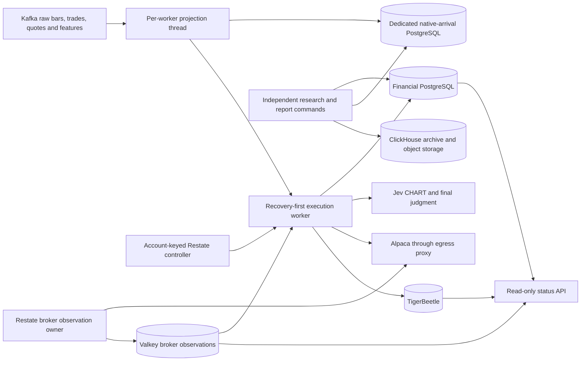
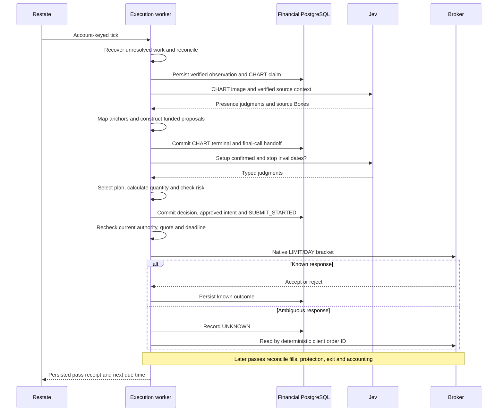
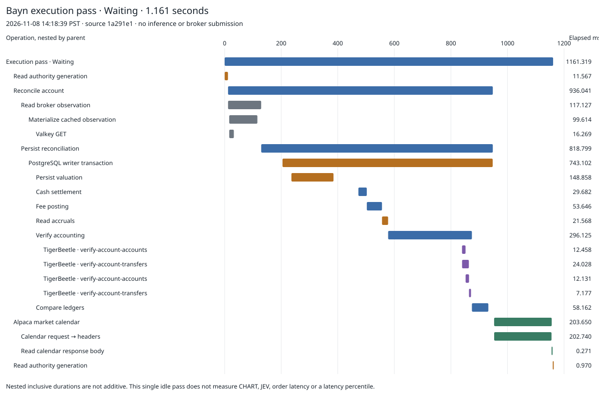

# Bayn system audit, 2026-11-08

## Scope and conclusion

Bayn implements one active, long-only equity entry strategy, two entry setups, broker recovery, and exact financial
accounting. It also contains a much larger collection of replay, research, assessment, retained-contract, and reporting
code. These are different workloads. They currently share too much source composition and the same deployable image.

This audit examines the system, not just its diagrams. The source baseline is
`ad8e10731e`, freshly fetched from `origin/main` on November 8. The inventory covers tracked Bayn files. The detailed
reads follow process entry points, market-data acquisition, strategy admission, inference, decision persistence,
submission, cancellation, reconciliation, accounting, controller recovery, research, image construction, and GitOps.

The evidence supports reducing the trading runtime's dependency closure, repeated historical reconstruction, and
large repeated evidence documents. It does not support changing disks, creating storage classes, removing accounting
checks, or deleting retained evidence. No runtime, capital authority, storage, or financial records changed during this
audit. The findings describe that baseline; the source cleanup below records subsequent implemented changes.

The accompanying [file inventory](evidence/2026-11-08-system-inventory.json) lists each tracked Bayn file, line count,
classification, and whether it contributes bytes to each of four locally built runtime entry points. Absence from those
four outputs is not proof that a file is unused: commands, tests, fixtures, research builds, and external callers remain
separate consumers. Git introduction and last-change commits are included for each file so the addition and its
subsequent changes can be inspected directly; file size alone does not attribute a design decision to a particular run.

The [database inventory](evidence/2026-11-08-database-inventory.json) records all 92 tables across the two databases,
their 742 columns and 184 indexes, relation sizes, and approximate row counts. The
[workload inventory](evidence/2026-11-08-workload-inventory.json) records 45 workload/claim resources, their images,
resource budgets, and current volume references. Neither contains account records, credentials or raw broker payloads.

## Source cleanup after the audit

The cleanup uses `8d6000317fad6a611e92cda41a535820c4e7eb69` as its before revision and Bun 1.4.2 for both
builds. These measurements are separate from the Bun 1.4.0 inventory below. The same three entry points, target,
externals and build options produce this comparison:

| Output                   | Before bytes | After bytes | Reduction | Bayn inputs emitting bytes, before → after |
| ------------------------ | -----------: | ----------: | --------: | -----------------------------------------: |
| Status API               |    7,830,266 |   5,821,591 |    25.65% |                                  512 → 210 |
| Execution endpoint       |   10,997,411 |  10,632,952 |     3.31% |                                  546 → 540 |
| Market projection thread |    3,423,572 |   2,284,752 |    33.26% |                                   259 → 53 |

The status composition now imports its resources directly. Its output contains no financial migration modules,
`observe-composition` cycle engine, or execution persistence constructor. Contract consumers import the existing
execution-store contract directly; the construction module no longer re-exports that contract. Risk-policy loading
lives with execution risk policy, independently of cycle startup. The forwarding lifecycle module and resource
aliases are removed, with all callers migrated.

The projection thread now imports the migration deadline independently of the financial migration registry. Its two
archive migrations, 15-minute deadline and failure behavior remain intact. No database schema or migration SQL changes.

Unused artifact schemas, their unused type exports and the unused input-manifest filter are removed. The manifest
filter had no runtime consumers; snapshot verification still checks provenance, hashes, calendars and coverage in
`market-data/verification`. Ledger event and reconciliation types remain. The two planner annotations now derive
weights from `RuntimeStrategyDecision` instead of the unused risk-balanced-trend decision artifact. The unused native
OpenCode origin and bid-breakout helper are deleted.

Reproduce the comparison at each revision with the same compiler, using different output paths:

```sh
npm exec --yes --package=bun@1.4.2 -- bun build services/bayn/src/index.ts \
  services/bayn/src/restate/restate-execution-server.ts \
  services/bayn/src/market-data/streaming/market-projection-worker.ts \
  --target=node --external tigerbeetle-node --external @platformatic/kafka \
  --outdir=/tmp/bayn-cleanup-bundles --metafile=/tmp/bayn-cleanup-metafile.json
```

These are unminified JavaScript byte counts and emitted-module counts. They establish smaller dependency closures;
they do not measure OCI closure, cold startup, request latency or trading returns. Research commands, retained readers,
financial history, reconciliation checks, writer fencing, permissions, storage and trading authority are preserved.

Local validation: the full unit suite passes with Bun 1.4.3, matching the CI unit-test version: 5,031 passed,
1,297 skipped, zero failed across 468 files. Both TypeScript projects, formatting, both lint modes, production and
research builds pass with Bun 1.4.2. The 137 focused behavior tests, 92 delivery tests and research command checks also
pass; the command checks use Node 24.11.1. Skipped tests are not established by local validation and require their
configured CI integration environments.

## System subtraction after the dependency cleanup

This follow-up starts at `b466a9e5e154b5a29ce4184bd672e5925244db98` (PR #15790). It changes runtime work,
not only imports. The measurements below use Bun 1.4.2 on the same machine and fixtures; PostgreSQL tests use a
disposable PostgreSQL 18 instance. They are not production request-latency measurements.

| Area                                                  |          Before |           After | Proof and retained behavior                                                                              |
| ----------------------------------------------------- | --------------: | --------------: | -------------------------------------------------------------------------------------------------------- |
| Jev no-trade decision JSON                            | 1,468,628 bytes | 1,193,564 bytes | One observation supplies the rows; every other document field except its content hash is identical       |
| Jev selected-entry decision JSON                      | 1,491,155 bytes | 1,216,080 bytes | Independent execution-pricing rows remain; streaming snapshots reproduce identically                     |
| Settled reconciliation accrual-history queries        |               3 |               2 | Actual SQL counted on both the initial stable cut and replay; one commit and exact reconciliation remain |
| Research server JavaScript                            | 7,432,445 bytes | 5,083,464 bytes | Same target, externals and compiler; AWS/Smithy emitted modules fall from 171 to zero                    |
| Validated strategy protocol copies per 10,000 lookups |          10,000 |               0 | Direct typed access returns the same object; external schema validation remains at ingress               |

The SEC/macro collector had no active trading or model-research consumer. Remove its eight source/test files,
startup activations, configuration, metric alert and unused TypeScript S3 dependency. Keep the existing capture bucket,
credentials and stored captures: GEPA uses that store through Python. Its environment names now describe research
captures and egress directly; all callers migrate together, with no aliases. The research endpoint serves
`BaynResearchRun` only. Existing public-collector timers must be canceled while their old endpoint remains reachable,
then checked again after registration of the replacement; see the owning
[retirement procedure](../../argocd/applications/bayn/README.md#research-capture-storage).
The two remaining scheduled collector invocations were gracefully canceled on November 8. Readback showed zero
outstanding invocations and the same two state records with an identical SHA-256 fingerprint before and after.
Repeat that readback after replacement-endpoint registration.

New protected-entry decisions persist observation rows once, inside their verified strategy evidence. The existing
financial reader still accepts retained documents and rejects any conflicting extra copy. Stored financial documents
are not rewritten. `shadow-decision.test.ts` compares complete document material, verifies both retained and compact
documents, reproduces their streaming snapshots and rejects a conflicting duplicate. Both fixture cases failed before
the change and pass afterward.

Fee posting returns its verified accrual records to reconciliation. A posting that changes `posted_at` rereads the
records before returning; a settled pass reuses its verified read. Full-history accounting reconstruction, ledger
verification and the writer fence remain. The PostgreSQL regression counted three queries before the change and two
after it; the complete persistence file passes all 40 tests, including posting recovery and replay.

Research-only strategy constructors move to `intraday-replay/strategy.ts`. Already validated protocol values no
longer cross repeated decoders or a fake asynchronous loader. Risk-policy selection is pure `Result` code, lifted
once by its effectful callers. Live and retained sandbox policy hashes and all budget limits remain unchanged.

The acquisition review found concrete consumers for the remaining feeds: Webull evidence reaches model input, and
crypto history supports retained exits and replay. Python, Git, Bun and Crane also have active research/replay
consumers in the shared image. This change does not introduce another image, cache, service or storage class to remove
them. Financial history, capture history and storage allocations are retained. Neither these byte reductions nor the
protocol microbenchmark establish a faster live tick, image startup or improved trading returns.

Local checks for this follow-up: 5,015 unit tests pass, 1,295 skip, zero fail across 464 files with Bun 1.4.3;
the 40 PostgreSQL persistence tests and 49 native Jev persistence tests pass against PostgreSQL 18. The latter cover
all nine native exit/recovery scenarios and retain the conflicting-source rejection check. Both TypeScript projects, formatting, both lint modes,
production and research builds, the research command smoke checks, 92 delivery tests and all seven GEPA tests pass.
The GEPA tests use the pinned upstream source and dependencies. Bayn and OpenCode manifests render successfully.
Skipped integrations still require their configured CI environments.

## Findings and deletion decisions

| ID  | Priority | Evidence                                                                                                                                                                                                                                                                                                   | Decision and smallest responsible change                                                                                                                                                                                                                                                               | Acceptance evidence                                                                                                                                                                                                         |
| --- | -------- | ---------------------------------------------------------------------------------------------------------------------------------------------------------------------------------------------------------------------------------------------------------------------------------------------------------- | ------------------------------------------------------------------------------------------------------------------------------------------------------------------------------------------------------------------------------------------------------------------------------------------------------ | --------------------------------------------------------------------------------------------------------------------------------------------------------------------------------------------------------------------------- |
| B1  | High     | A local build of the read-only API emits bytes from 512 Bayn inputs, including about 986 kB of migrations and execution/decision implementations. Its resources do not acquire mutation stores, but imports still pull them into the bundle.                                                               | Remove execution and migration imports from the status process's dependency closure. Give the existing read-only composition its own resource imports. Preserve its status contracts and accounting readback.                                                                                          | Compare emitted modules and bytes before and after; exercise health and status with the same durable evidence; prove mutation resources remain absent.                                                                      |
| B11 | High     | The status Deployment receives `bayn-db-app` and the broker credential secret also used by execution. `PostgresClientLive` defaults to a writable connection; the live `bayn_app` role can INSERT and UPDATE intents. Read-only behavior is enforced by application composition, not credential privilege. | Remove credentials/capabilities that status does not need. Reuse broker observations, narrow the status SQL identity, and verify every health/status reader before changing deployment wiring. Permission changes require a separately reviewed authorization decision.                                | Role grants, connection read-only enforcement, unchanged status/health behavior, and proof that status credentials cannot mutate trading state. This audit demonstrates excess privilege, not a remotely exploitable route. |
| B2  | High     | The single Nix image includes research and frozen-control executables, compiler dependencies, GEPA Python, Bun, Git, and registry tooling for every deployed role.                                                                                                                                         | Separate the required execution/status payload from research-only tools through the existing image build. Do not introduce another service or generic plugin system. Keep research reproducible in its owning workload.                                                                                | Inspect actual OCI contents and closure sizes, required commands, release receipts, and all role entry points. Local JavaScript bundle sizes alone do not measure this saving.                                              |
| B3  | High     | Every full reconciliation reads account-wide intents, receipts, fills, transactions, projected inventory, and TigerBeetle account history. Those reads and ledger verification occur while the writer transaction owns the fence.                                                                          | Eliminate repeated preparation and unnecessary SQL round trips first. Measure each historical read before designing incremental verification. An incremental path must verify corrections, missing records, unknown mutations, and the complete ledger; a short-lived unchecked cache is insufficient. | Representative history-size benchmarks, exact same discrepancies/accounting output, crash and correction tests, plus comparable live transaction timings.                                                                   |
| B4  | High     | `workerStreamingUniverse` always includes equity and crypto sources. Each physical execution worker creates its own projection and arrival capture, although new crypto entries are disabled. The live readback contained four execution Pods across two revisions.                                        | Remove work with no current entry or recovery consumer. First measure bytes and CPU by topic and worker role. Separate entry history from the minimal evidence needed to manage retained crypto positions. Do not drop their exits or quote requirements.                                              | Same equity decisions, unchanged crypto close/recovery behavior, complete required arrival evidence, and measured reduction per worker. Quantify overlapping captures before changing ownership.                            |
| B5  | Medium   | Retained decision documents occupy about 5.5 GiB, candidate observations about 4 GiB, and snapshot references about 880 MiB in the financial database. A 32-row historical sample expands to about 1.03 MB per decision document and 373 kB per candidate payload.                                         | Stop copying identical evidence into new document shapes where a verified content reference suffices. Trace every reader and canonical hash first. Preserve old immutable bytes and their readers. These sample sizes do not establish current v40 per-cycle growth.                                   | Reproduce identical decisions, risk inputs, report joins, request hashes, and recovery from referenced evidence; measure bytes and decoding time on new records.                                                            |
| B6  | Medium   | The financial database still contains 43 GB of native-arrival chunks. The dedicated arrival database contains 118 GB. The runtime requires the dedicated archive endpoint.                                                                                                                                 | Inventory capture ranges, manifests, exports, and research consumers. Remove obsolete write paths or duplicated future capture only after proving the consumer graph. Historical data deletion is a separate retention decision, not a performance fix.                                                | Exact capture/content-hash comparison and all dependent report/replay joins. No record is declared redundant merely because both databases contain arrival tables.                                                          |
| B7  | Medium   | Six 10 GiB claims from the older `drc-bayn-valkey` layout have no current Pod reference. The 2 GiB OpenCode state claim is also unmounted and explicitly retained in desired state.                                                                                                                        | Treat these as cleanup candidates, not empty disks. Verify former controllers, operator desired state, retained contents, and recovery obligations. Remove obsolete desired-state references before any separately authorized deletion.                                                                | Controller/claim/PV ownership and content readback. Keep the two mounted Valkey claims and all financial/ledger volumes.                                                                                                    |
| B8  | Medium   | The active strategy module and candidate persistence also contain repeated-momentum and ablation branches. The built API and execution outputs contain those implementations even though production selects `jev`.                                                                                         | Remove research strategy construction from the active trading composition. Keep shared arithmetic and the explicit research callers. This is a dependency-boundary change, not permission to delete control experiments.                                                                               | Bundle membership and runtime selection tests, plus matched-control and retained-evidence tests.                                                                                                                            |
| B9  | Medium   | A captured worker pass returned `Waiting`; the available waterfall has no inference or order submission. Its full Restate lifetime includes an unattributed interval before the attempt.                                                                                                                   | Complete request-level timing across admission, CHART, handoff commit, JEV, decision commit, submission, acknowledgement, and recovery. Separate scheduled delay from lateness. Reuse existing IDs and tracing.                                                                                        | A natural eligible-session trace joined to persisted receipts and broker outcome, including expired/rejected requests. Do not force a trade for a trace.                                                                    |
| B10 | Medium   | The architecture page described v20, Jev 1.13, a sixteen-plan search, and absent judgment thresholds. Current source uses v40, Jev 1.14 Box localization, two proposals, and 0.70 judgment gates. Deployment/service READMEs also accumulate many historical cutovers before current operations.           | Correct the architecture page and consolidate current operating instructions. Move unique historical explanations out of the current path; remove duplicate narrative after checking links. Retained financial schemas have a different retention requirement from obsolete prose.                     | Current source links, document-link checks, and review against the owning README and release contract.                                                                                                                      |

These findings are structural or directly observed. B3 identifies repeated account-history work, not a proven slow
database server. B4 identifies unconditional source acquisition, not a measured percentage of wasted traffic. B5 and
B6 identify retention and representation costs, not permission to erase evidence. No line-saving or speed-up estimate
is claimed before a concrete replacement and before/after measurement exist.

## What is actually present

The following counts describe non-generated TypeScript under `services/bayn/src`. Test support includes filenames
containing `.test.` or `.test-support`, and the `testing` directory. The other column means non-test source; it includes
research and retained readers and must not be read as code executed on each tick.

| Source owner                | Non-test files | Non-test lines | Test/support files | Test/support lines | Role                                                                               |
| --------------------------- | -------------: | -------------: | -----------------: | -----------------: | ---------------------------------------------------------------------------------- |
| Root modules                |             68 |         17,132 |                 76 |             32,882 | Entry points, contracts, status, configuration, telemetry, research commands       |
| `intraday-replay`           |             47 |         15,513 |                 70 |             24,052 | Historical simulator, latency/fill models, controls, backtests                     |
| `jev`                       |             81 |         14,844 |                 78 |             16,983 | Current and retained model inputs, charts, proposals, paid-call evidence           |
| `market-data`               |             57 |         12,617 |                 49 |             12,941 | Kafka, projection, feature contracts, snapshots, native arrivals, archive readers  |
| `execution`                 |             39 |         12,233 |                 25 |             14,377 | Authority, intents, mutations, risk boundaries, scheduling outcomes, writer fence  |
| `system-assessment`         |             58 |         12,139 |                 65 |             17,135 | Registration, historical reliability/economic assessment and evidence verification |
| `db`                        |             42 |         10,356 |                 46 |             21,884 | Persistence interpreters, financial reads, reconciliation, migration composition   |
| `observe-composition`       |             13 |          7,300 |                 10 |              3,672 | Recovery-first orchestration, decision construction and mutation interpretation    |
| `cycle`                     |             32 |          6,503 |                 20 |              5,993 | Durable lifecycle, source binding, terminalization and observability               |
| `broker`                    |             27 |          6,461 |                 20 |              7,822 | Alpaca reads, observation cache, mutation encoding and transport                   |
| `forward-performance`       |             21 |          6,449 |                 20 |              9,394 | Broker/accounting/evidence joins and costed performance reports                    |
| `composition`               |             12 |          2,800 |                 12 |              3,986 | Scoped resources, status and native runtime acquisition                            |
| `strategy`                  |             18 |          2,741 |                  7 |              1,586 | Shared strategy model and research controls                                        |
| `restate`                   |             11 |          2,254 |                 11 |              4,831 | Execution, broker observation, activation, and research service endpoints          |
| `simulation-reconciliation` |             11 |          2,101 |                  3 |                326 | Broker snapshot normalization and reconciliation orchestration                     |
| `target-planner`            |              5 |          1,482 |                  0 |                  0 | Funded position targets and executable deltas                                      |
| `ledger-plan`               |              6 |          1,427 |                  0 |                  0 | Deterministic accounting accounts/transfers and exact comparison                   |
| `research-inference`        |              8 |          1,249 |                  5 |                999 | Separately approved research inference workflow                                    |
| `accounting`                |              7 |          1,168 |                  4 |                954 | Fill, fee, cash-settlement and cost-basis math                                     |
| `reconciliation`            |              2 |          1,067 |                  2 |              1,363 | Pure comparison and historical accounting verification                             |
| `health`                    |              3 |            841 |                  1 |                112 | Health/readiness projection                                                        |
| `config`                    |              5 |            839 |                  1 |                 87 | Startup parsing and runtime/historical configuration                               |
| `opencode`                  |              3 |            627 |                  3 |                417 | Research-side gateway/configuration                                                |
| `ledger`                    |              2 |            320 |                  1 |                288 | TigerBeetle account-history reads and comparisons                                  |
| `testing`                   |              0 |              0 |                 20 |              1,698 | Shared test fixtures                                                               |
| **Total**                   |        **578** |    **140,463** |            **549** |        **183,782** | **1,127 TypeScript files**                                                         |

The service also has 189 migration modules and 42 TypeScript tools. `docs/bayn` contains 43 Markdown files before
this report. The large test count is not evidence of complete runtime coverage. It also is not a reason to delete
tests without understanding the financial or failure contract each one protects.

## Processes, owners, and shipped contents

| Process                           | Entry point                                                                                                                                  | Acquired capabilities                                                                       | Writes or side effects                                                         |
| --------------------------------- | -------------------------------------------------------------------------------------------------------------------------------------------- | ------------------------------------------------------------------------------------------- | ------------------------------------------------------------------------------ |
| Public status API                 | [`index.ts`](../../services/bayn/src/index.ts), [`composition/read-only-status.ts`](../../services/bayn/src/composition/read-only-status.ts) | HTTP, PostgreSQL reads, broker observations, accounting health                              | Status/metrics responses; it does not acquire trading mutation stores          |
| Native execution endpoint         | [`restate-execution-server.ts`](../../services/bayn/src/restate/restate-execution-server.ts)                                                 | Restate identity validation, native runtime, broker observation runtime, expense projection | Authorized cycle/intent/mutation/accounting persistence and broker I/O         |
| Market projection thread          | [`market-projection-worker.ts`](../../services/bayn/src/market-data/streaming/market-projection-worker.ts)                                   | Kafka consumers, in-memory verified projection, dedicated arrival archive                   | Append-only arrival evidence, worker replies                                   |
| Broker observation virtual object | [`restate-broker-observations.ts`](../../services/bayn/src/restate/restate-broker-observations.ts)                                           | Broker reads, durable scheduling, Valkey materialization                                    | Cached observations; no order authority                                        |
| Activation job                    | [`restate-execution-activate.ts`](../../services/bayn/src/restate/restate-execution-activate.ts)                                             | Exact build/account/request verification, private controller endpoint                       | Reviewed same-account activation/deactivation and successor identity           |
| Independent research endpoint     | [`restate-research-server.ts`](../../services/bayn/src/restate/restate-research-server.ts)                                                   | Research approval, research database role, TypeSafe and object storage                      | Approved research receipts and separately enabled public-information captures  |
| Offline/report commands           | [`package.json`](../../services/bayn/package.json), [`nix/images/bayn.nix`](../../nix/images/bayn.nix)                                       | Command-specific retained inputs, archive reads, reports, control compilers                 | Research outputs and explicitly invoked reports; not native trading scheduling |

The local Bun 1.4.0 build emitted the following unminified outputs. The package requests Bun 1.4.2. These are diagnostic
source builds, not pinned release builds, OCI sizes or startup latency measurements. `nix develop` could not connect
to the local Nix daemon, so a pinned comparison remains pending. Compiler defines, version, and Nix closure
construction can change the final image bytes.

| Runtime output           |      Bytes | Bayn inputs contributing bytes |
| ------------------------ | ---------: | -----------------------------: |
| Status API               |  8,659,717 |                            512 |
| Execution endpoint       | 11,851,522 |                            546 |
| Market projection thread |  6,566,432 |                            259 |
| Research endpoint        | 10,080,048 |                            124 |

The status, execution, and projection outputs each include roughly 986 kB attributed to Bayn migrations. The first
two include repeated-momentum and entry-ablation implementations. These observations establish bundle coupling;
they do not mean status handlers execute a trade or run those migrations.

Reproduce the build inventory without touching `dist`:

```sh
bun build services/bayn/src/index.ts \
  services/bayn/src/restate/restate-execution-server.ts \
  services/bayn/src/market-data/streaming/market-projection-worker.ts \
  services/bayn/src/restate/restate-research-server.ts \
  --target=node --external tigerbeetle-node --external @platformatic/kafka \
  --outdir=/tmp/bayn-system-audit-bundles --metafile=/tmp/bayn-system-audit-metafile.json
```

### Dependency and authority map



Restate owns account-key serialization, durable delivery and successor scheduling. PostgreSQL owns the transactional
writer fence, committed intents and mutation state. Neither replaces the other: a serialized handler can crash after
broker I/O but before its completion is durable. The recorded request identity and reconciliation resolve that gap.

## Entry request, step by step

| Step | Owning code                                                                                                                                                                                                 | Work and durable boundary                                                                              | Timing/concurrency                                                              | Failure behavior                                                                              |
| ---- | ----------------------------------------------------------------------------------------------------------------------------------------------------------------------------------------------------------- | ------------------------------------------------------------------------------------------------------ | ------------------------------------------------------------------------------- | --------------------------------------------------------------------------------------------- |
| 1    | [`restate-execution-controller.ts`](../../services/bayn/src/restate/restate-execution-controller.ts)                                                                                                        | Decode tick, verify key/revision/epoch/sequence and recorded controller state                          | One exclusive object handler per account; bounded recovery windows              | Foreign/stale work quiesces; accepted failures retain bounded recovery semantics              |
| 2    | [`native-execution-runtime.ts`](../../services/bayn/src/composition/native-execution-runtime.ts), [`advance.ts`](../../services/bayn/src/execution/advance.ts)                                              | Bind the process runtime, recover already projected completion, execute one pass                       | Process-scoped resources; one bounded advance                                   | No new receipt is fabricated for an unfinished pass                                           |
| 3    | [`recovery-driver.ts`](../../services/bayn/src/observe-composition/recovery-driver.ts)                                                                                                                      | Recover pending cancellation/submission and obtain fresh exact reconciliation                          | Existing narrow reuse is authority-, freshness-, and state-bound                | Unknown mutations and discrepancies block new exposure                                        |
| 4    | [`streaming/worker.ts`](../../services/bayn/src/market-data/streaming/worker.ts), [`streaming/service.ts`](../../services/bayn/src/market-data/streaming/service.ts)                                        | Read verified projection, original arrival references and source-bound completed bars/quotes           | Ingestion runs in a separate thread; replacement workers warm before activation | Missing/late candidate evidence remains an exclusion; invalid global evidence fails admission |
| 5    | [`candidate-observation-postgres.ts`](../../services/bayn/src/db/candidate-observation-postgres.ts)                                                                                                         | Reproduce candidate observation and bind source/account/reconciliation identities before insertion     | Financial database durability precedes strategy authority                       | Hash/source/readback mismatch fails closed                                                    |
| 6    | [`entry-proposals.ts`](../../services/bayn/src/jev/entry-proposals.ts)                                                                                                                                      | Check whether source prices and fees permit any funded proposal                                        | Pure fixed-point arithmetic; skip paid work when source-infeasible              | No affordable plan means no paid final judgment and no entry                                  |
| 7    | [`entry-inference-batch.ts`](../../services/bayn/src/jev/entry-inference-batch.ts)                                                                                                                          | Persist CHART claim, then ask structure presence and source-image Boxes                                | Candidate pipelines run concurrently; share original evidence deadline          | Cancellation, late results and unknown consumption retain receipts/cost uncertainty           |
| 8    | Same module plus [`entry-inference-postgres.ts`](../../services/bayn/src/db/entry-inference-postgres.ts)                                                                                                    | Map valid source anchors, construct proposals, atomically commit CHART terminal and final-call handoff | Each ready candidate may advance before other CHART calls finish                | No final paid dispatch before its handoff commits                                             |
| 9    | [`entry-questions.ts`](../../services/bayn/src/jev/entry-questions.ts)                                                                                                                                      | Ask setup confirmation and stop invalidation, then select an eligible proposal                         | Both judgments must be at least 0.70; no fresh ten-second budget                | Uncertain, invalid or expired evidence cannot become an approved trade                        |
| 10   | [`decision-builder.ts`](../../services/bayn/src/observe-composition/decision-builder.ts), [`target-planner`](../../services/bayn/src/target-planner/index.ts), [`risk.ts`](../../services/bayn/src/risk.ts) | Construct target, whole-share delta, risk decisions and immutable decision evidence                    | Prices, fees, quantity and limits remain code-owned                             | A model answer does not override capital, liquidity, exposure, turnover, loss or cutoff gates |
| 11   | [`cycle/store/postgres.ts`](../../services/bayn/src/cycle/store/postgres.ts), [`execution/coordinator.ts`](../../services/bayn/src/execution/coordinator.ts)                                                | Commit approved intent, deterministic client ID and canonical request, then `SUBMIT_STARTED`           | Recheck current gates immediately before broker I/O                             | Unknown submission blocks exposure and uses deterministic lookup; no blind POST retry         |
| 12   | [`execution-cycle.ts`](../../services/bayn/src/observe-composition/execution-cycle.ts)                                                                                                                      | Manage protection, residual inventory, close and later exact reconciliation                            | Acknowledgement is distinct from fill and terminal flat completion              | An incomplete/partial/ambiguous close remains incomplete                                      |
| 13   | [`native-execution-runtime.ts`](../../services/bayn/src/composition/native-execution-runtime.ts), Restate controller                                                                                        | Project pass receipt, advance sequence and schedule one successor                                      | The persisted due time includes projection/journaling elapsed time              | A projection failure is not silently reported as completed execution                          |



## What the strategy actually decides

The active contract is `bayn.jev.protocol.v40`, model `jev-1.14.0`, numerical input v24, batch v8, entry input v8, and
handoff v5. New entries permit equities only. Retained crypto positions continue through the existing risk-reducing
exit and reconciliation path. Research supports additional policies; they are not selected native entry strategies.

| Decision                  | Source rule                                                                           | Code-owned arithmetic                                                                                |
| ------------------------- | ------------------------------------------------------------------------------------- | ---------------------------------------------------------------------------------------------------- |
| Support identification    | Most recent defended support below bid, with a rebound after testing                  | Map a valid Box to original candle IDs; do not accept a falling newest low merely as support         |
| Resistance identification | Nearest identifiable observed overhead resistance                                     | Use the source resistance candle's high, not a model-generated price                                 |
| Base identification       | At least two overlapping completed candles; exclude newest candle; no source-time gap | Derive the full high/low range from original candles                                                 |
| Support recovery proposal | Requires usable support and resistance, followed by recovery confirmation             | Stop rounded below support low; target rounded below observed resistance high                        |
| Base breakout proposal    | Requires coherent base, bid above base high, and acceptance above the base            | Stop rounded below base low; target is `2 * high - low`, rounded down                                |
| Funding                   | Acquisition and modeled exit fees must be supportable                                 | Fixed-point price/quantity/fee arithmetic; target net covers acquisition and stop net is below it    |
| Final judgment            | Setup confirmation and stop invalidation both at least 0.70                           | Rank eligible proposals by the lower judgment, then lower modeled stop loss, then stable proposal ID |
| Position                  | At most one long, up to 20% gross and per-symbol equity weight                        | Further bounded by actual account/risk/liquidity/turnover limits                                     |
| Time                      | First completed equity minute plus two seconds; no extra clock warmup                 | Original ten-second inference validity; ten-second quote age; fifteen-minute maximum hold            |
| Session end               | Entries stop and flattening starts five minutes before actual close                   | Reconcile residual inventory and order state; an unfilled close is not a completed close             |

Selection has two levels. [`selectSupportedEntryProposal`](../../services/bayn/src/jev/entry-questions.ts) selects a
proposal within each symbol. [`selectJevEntryCandidates`](../../services/bayn/src/jev/decision.ts) then ranks symbols by
the same minimum judgment, lower absolute modeled loss, and finally symbol name. It takes only `maximumPositions`,
currently one. It does not rank by estimated net return, return per unit risk, or a calibrated win probability.

Parallelism also has two boundaries. A candidate's final JEV can overlap another candidate's CHART, but the evaluator
still settles the batch before deriving the portfolio target. A fast candidate does not immediately become an order.
The benefit and cost of scoring the entire candidate set for one position must be measured using dispatch counts,
paid unsuccessful calls, tail latency, and costed matched controls. Pruning candidates or taking the first completed
answer changes the selection policy; it is not a free concurrency optimization.

The 0.70 threshold, source selection, and target construction are policies, not proof of an economic edge. A useful
strategy breakdown must join each setup's candidates, exclusions, source feasibility, CHART outcomes, final judgments,
risk denials, submissions, fills, exits, and all costs. Existing reporting and control code should supply that evidence
before adding another strategy or changing thresholds. No new profitability result was calculated in this audit.

## Reconciliation and accounting in detail

[`broker-reconciler-program.ts`](../../services/bayn/src/simulation-reconciliation/broker-reconciler-program.ts) reads
a stable broker snapshot, then normalizes and persists it. Broker observations may come from the required Valkey
materialization; this does not imply a complete broker HTTP poll on every worker pass.

The persistence path does the following:

1. Acquire the writer transaction and account advisory lock.
2. Recover already committed, pending cash/fee postings before ingesting new fills.
3. Ingest account/position/order events, account incomplete fills, and value the account.
4. Prepare cash settlements, observed coin fees, fee activities, and cash-fee accruals.
5. When no new posting is needed, finalize verification in the same transaction using a savepoint. Otherwise commit
   preparation and run the posting/verification transaction separately.
6. Read intent expectations and broker-generated protection children.
7. Reconstruct accounting history, decode receipts and reproduce expected plans.
8. Query TigerBeetle accounts/transfers and compare complete expected records.
9. Read durable fills and aggregate inventory/cost basis; compare broker cash, positions, orders, fees and receipts.
10. Persist exact reconciliation or its discrepancies, restrict authority when needed, and derive current risk context.

The savepoint and two-phase posting paths exist because PostgreSQL and TigerBeetle do not share a transaction. They
cannot be replaced by a generic retry without risking duplication or erasing prepared financial evidence.

The expensive repeated work is visible in [`db/reconciliation.ts`](../../services/bayn/src/db/reconciliation.ts):
`readAccountingPhase` selects all account intents with lateral mutation lookups, `readAccountingHistory` reconstructs
the account's transactions, receipt reads cover the account's transaction history, and `readComparisonPhase` reads all
durable fills and aggregates inventory. [`ledger.ts`](../../services/bayn/src/ledger.ts) assembles the complete expected
account plan and [`ledger/account-read.ts`](../../services/bayn/src/ledger/account-read.ts) paginates ledger records.

This scales with accumulated history, not just changes since the previous pass. The observed account has approximately
851 fills/transactions, 966 receipts and 687 intents according to PostgreSQL statistics. These are approximate table
counts, not trading results or a claim about today's fills. Measure realistic larger histories before selecting a
replacement; preserve full verification and test unexpected extra ledger records, corrections and incomplete postings.

## Measured request timing

The retained trace is `68fb4647c96b52673b880b64678bfc0`, captured November 8 at 14:18:39 PST on source
`1a291e1ad1ce0931efa307b0090df3080ec7379b`. It predates the source audit baseline. Its outcome was `Waiting`; it has
no CHART, JEV, or broker order submission. It is a reconciliation example, not an entry latency benchmark.



| Span                       | Start relative to worker pass, ms | Inclusive duration, ms | Interpretation                                                       |
| -------------------------- | --------------------------------: | ---------------------: | -------------------------------------------------------------------- |
| Worker advance             |                             0.000 |              1,161.319 | Complete measured worker pass                                        |
| Reconciliation             |                            12.054 |                936.041 | Includes broker observation and persistence                          |
| Broker observation         |                            12.076 |                117.127 | Includes cached observation materialization                          |
| Valkey GET                 |                            16.300 |                 16.269 | Nested cache operation                                               |
| Reconciliation persistence |                           129.282 |                818.799 | Includes preparation, accounting and transaction work                |
| Writer transaction         |                           204.561 |                743.102 | Application work inside a transaction, not pure SQL or fsync latency |
| Valuation                  |                           236.071 |                148.858 | Nested persistence operation                                         |
| Accounting verification    |                           578.032 |                296.125 | Includes history preparation and ledger requests                     |
| Ledger comparison          |                           874.207 |                 58.162 | Nested comparison work                                               |
| Alpaca market calendar     |                           952.717 |                203.650 | Request-to-headers accounts for 202.740 ms                           |

Nested inclusive times cannot be added. The complete captured Restate lifecycle spans 31,141.838 ms. The
`invocation-start` span lasts 25,972.502 ms before the attempt begins. Its cause is unassigned by this trace.
The controller intentionally schedules delayed ticks; the interval must be joined to its due time before calling
it scheduling lateness. The trace is not evidence of a 31-second model call or slow storage.

The [sanitized timing data](evidence/2026-11-08-execution-waiting.json) retains the span hierarchy. A bounded 48-hour
inference trace search in the preceding investigation found no inference-containing trace. Missing search results do
not prove that no inference occurred. A natural-session CHART/JEV/order waterfall and representative latency
distribution remain unverified.

## Data and infrastructure inventory

Read-only Kubernetes and PostgreSQL inspection succeeded during this audit. The financial size/statistics query ran
on `bayn-db-1`, a replica; the 88-table and connection inventory was confirmed on primary `bayn-db-2`. The native
archive query ran on primary `bayn-native-arrival-db-1`. Statistics are approximate and measurements are time-bound.
Later Kubernetes API requests timed out and were stopped. They did not produce newer payload samples. A subsequent
bounded retry restored catalog/workload inspection; the inventories include its own capture timestamps. The failed
recent-payload samples were not treated as successful measurements.

The complete catalog includes all table columns and index definitions. The status Deployment's financial database
secret refers to the `bayn_app` owner configured by the CNPG bootstrap. Read-only privilege inspection confirms that
role can insert and update `intents`. The current application avoids mutation by composition; it does not have a
database privilege boundary equivalent to that read-only purpose.

| Store                        | Observed size or allocation                                         | Consumer and retention boundary                                                             |
| ---------------------------- | ------------------------------------------------------------------- | ------------------------------------------------------------------------------------------- |
| Financial PostgreSQL         | 57 GB logical database; two 100 GiB data and two 32 GiB WAL claims  | 88 user tables; durable financial state, decisions, inference receipts, historical arrivals |
| Dedicated arrival PostgreSQL | 118 GB logical database; two 200 GiB data and two 32 GiB WAL claims | Four tables; 29 epoch rows estimated; source-arrival replay and evidence                    |
| TigerBeetle                  | Three members with 100 GiB claims each                              | Exact cash, fees, cost basis, realized P&L; this audit did not measure file occupancy       |
| Valkey                       | Two mounted 10 GiB claims                                           | Broker observation materializations; cache availability/freshness is part of admission      |
| Older Valkey claims          | Six unmounted 10 GiB claims                                         | No current Pod references; retained contents and former controller ownership not audited    |
| OpenCode retained state      | One unmounted 2 GiB claim                                           | Explicitly retained desired state; no current Pod consumer observed                         |
| ClickHouse                   | Not sized in this audit                                             | Read-only market archive and report/replay input                                            |
| Object storage               | Not sized in this audit                                             | Backups, research captures and report artifacts                                             |
| Restate                      | Shared platform storage not sized in this audit                     | Invocation journal, virtual-object state, delayed delivery and retries                      |

Largest financial relations, including indexes and TOAST where applicable:

| Relation                            | Observed total size | Approximate live rows | Purpose                                       |
| ----------------------------------- | ------------------: | --------------------: | --------------------------------------------- |
| `native_arrival_chunks`             |               43 GB |             1,788,824 | Historical compressed arrival evidence        |
| `autonomous_cycle_shadow_decisions` |            5,654 MB |                11,772 | Immutable bound decision documents            |
| `intraday_candidate_observations`   |            4,047 MB |                16,926 | Verified candidate inputs/decisions/manifests |
| `streaming_snapshot_references`     |              880 MB |                12,161 | Snapshot provenance references                |
| `broker_events`                     |              668 MB |               223,038 | Observed broker event history                 |
| `jev_evaluation_requests`           |              526 MB |                41,146 | Original request evidence                     |
| `jev_batch_plans`                   |              476 MB |                16,798 | Batch identity and candidate evidence         |
| `execution_controller_observations` |              342 MB |                13,844 | Retained controller pass/status observations  |
| `position_snapshots`                |              229 MB |               215,465 | Reconciled inventory observations             |
| `inference_expense_quotes`          |              188 MB |                78,927 | Inference expense evidence and pricing        |
| `execution_unit_cutover_archive`    |              182 MB |               198,858 | Retained cutover records                      |
| `valuations`                        |              176 MB |               215,465 | Account valuation history                     |
| `reconciliations`                   |              138 MB |               224,991 | Financial comparison receipts                 |

The native archive's chunk relation accounts for approximately its entire 118 GB. Its chunks are compressed and
hash-chained; epoch identity includes source build and consumer bootstrap. Repeated market bytes across workers do
not automatically mean interchangeable evidence because original availability time and consumer epoch matter.

Observed compute consisted of two status Pods, four execution Pods across two revisions, one research Pod, two
egress proxy Pods, two telemetry Pods, four PostgreSQL Pods, three ledger Pods, and two Valkey Pods. A source rollout
can retain predecessor workers while the replacement pool warms. This snapshot alone does not establish abandoned
workers or excessive steady-state replicas.

## Research, assessment and retained contracts

| Area                                    | Current purpose                                                                                                 | Keep, isolate, or remove                                                                                                                                                                  |
| --------------------------------------- | --------------------------------------------------------------------------------------------------------------- | ----------------------------------------------------------------------------------------------------------------------------------------------------------------------------------------- |
| Intraday replay and broker simulation   | Reproduce arrival ordering, fills, latency, partial fills, cancellations, controls and economics                | Keep the execution model and evidence checks; isolate offline payload from status/trading images where practical                                                                          |
| System assessment                       | Register immutable configuration, account for full observation windows, verify historical reliability/economics | Keep distinct from capital authority; remove duplicated current descriptions rather than weakening gates                                                                                  |
| Repeated momentum and entry ablation    | Mechanical comparison/control paths                                                                             | Keep explicit research consumers; remove their construction branches from the native strategy composition                                                                                 |
| Frozen control compiler                 | Comparable baseline independent of current implementation                                                       | Preserve exact compiler/source identity; isolate from trading runtime payload                                                                                                             |
| GEPA and instruction variants           | Paid, approved prompt/instruction research                                                                      | Research-only dependency; not required to execute a native tick                                                                                                                           |
| Public information                      | Independently scheduled SEC and macro captures with object-storage evidence                                     | No active Jev/strategy input reference was found in the searched owning directories. Attribute its costs and research consumers separately; do not describe it as required entry evidence |
| Webull archive/research                 | Source comparison and retained context                                                                          | Separate ingestion entitlement/arrival evidence from research usefulness                                                                                                                  |
| Retained v24-v39 and Jev 1.13 contracts | Decode/reproduce old paid and financial evidence                                                                | Keep necessary immutable readers; new execution accepts v40 only                                                                                                                          |
| Historical BASE_START                   | Original staged-call/cost accounting                                                                            | Already retired for new v40 requests. Do not report its retirement as unfinished cleanup                                                                                                  |

## Removal order and proof required

1. Remove stale current-architecture statements and publish this source/consumer inventory.
2. Shrink the status process dependency closure. Preserve existing response and authorization behavior.
3. Shrink the deployed runtime payload using the existing build and release machinery; retain reproducible research
   in its own workload. Measure OCI closure and runtime behavior before calling this a startup improvement.
4. Attribute reconciliation time, then remove repeated work with regression evidence for accounting and recovery.
5. Attribute continuous capture by market, source revision and worker. Reduce unused acquisition only with explicit
   entry/recovery requirements and original-arrival proof preserved.
6. Replace redundant future evidence copies with verified references, changing all writers/readers/contracts together.
7. Review retained data and unused claims separately. Capacity reclamation must not be bundled with latency work.

This ordering yields independently reviewable changes. It avoids a storage migration, a framework rewrite, a new
scheduler, a new caching layer, a strategy expansion, or relaxed financial controls as a substitute for evidence.

## Original audit verification boundary

Completed: tracked-file inventory, four actual bundle builds and module attribution, critical source-path review,
current protocol/proposal/risk/submission/recovery ownership review, read-only cluster inventory, read-only database
size/statistics/sample queries, and comparison with the retained trace. Documentation links and formatting are
validated as part of this change.

Not established: a line-by-line audit of every source/test/migration, live request-to-fill latency, the cause of the
pre-attempt interval, current v40 document growth, historical capture equivalence, safe deletion of any volume,
ClickHouse/object-store occupancy, complete strategy profitability, or a measured speed-up. Full trading/ledger tests
were not run for this documentation-only change; no executable path was changed. The file inventory is a coverage
map, not a claim that every listed implementation has passed a correctness audit.
