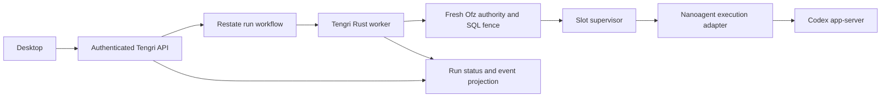

# Durable execution for Tengri agents

Status: Research recommendation, 2026-10-20. No runtime implementation or rollout.

Source baseline: `eef9909c73b047fa1224a415fe061522188d089a`, verified against freshly fetched `origin/main`.
Atlas returned that same commit. External documentation and release notes were checked during this investigation.
Repository source and desired state were inspected. Production health and performance were not measured.

## Recommendation

Use **Restate as Tengri's single durable agent-run orchestrator**, with a Rust worker outside the user microVM.
Keep Firecracker and Nanoagent responsible for the execution environment, and Ofz responsible for authorization.
Do not add a general workflow abstraction or a second scheduler.

Restate's keyed state, durable calls, timers, and workflows fit interactive runs that wait for approvals or guest
recovery. Its Rust SDK exposes these directly. The repository already declares Restate and its operator, so adoption
can reuse an existing delivery path. This is a judgment about integration and maintenance cost, not a measured
performance advantage over Temporal.
[Rust capabilities](https://docs.rs/restate-sdk/0.12.1/restate_sdk/),
[existing Restate deployment](../../argocd/applications/restate/kustomization.yaml).

Temporal is the strongest alternative. Its Rust SDK reached general availability in September 2026, and the repository
already contains Temporal infrastructure. Select it instead if standardizing application orchestration on Temporal
outweighs Restate's fit with Tengri's service architecture. Do not reject Temporal on the outdated claim that it lacks
a stable Rust SDK.
[Temporal 1.0 release](https://github.com/temporalio/sdk-rust/releases/tag/v1.0.0),
[existing Temporal deployment](../../argocd/applications/temporal/README.md).

The most consequential requirement is independent of that choice. Wrapping the current Codex `turn/start` call in a
durable workflow cannot make the model's internal tool loop durable. The first deliverable can recover accepted runs
and reconcile Codex turns. Full recovery at individual model and tool steps requires explicit integration with those
steps. Arbitrary shell and browser actions still need an honest unknown-outcome state.

## The gap in the current execution path

The current path is browser, authenticated BFF, Rust Tengri, slot supervisor, Go Nanoagent, then Codex app-server.
Threads and credentials live in the retained home. This is an interactive Codex client, with no AgentRun in that path.
[Chat architecture](agent-chat.md).

| Boundary            | Current source evidence                                                                                                                              | Consequence for durable execution                                                                                               |
| ------------------- | ---------------------------------------------------------------------------------------------------------------------------------------------------- | ------------------------------------------------------------------------------------------------------------------------------- |
| Submission          | `SendCodexInputRequest` contains thread, input, model, effort, and images. It has no stable run or operation ID. Tengri forwards it to `turn/start`. | A retry after a lost response has no application-level identity with which to prove it is the same submission.                  |
| Process supervision | Nanoagent restarts Codex with backoff. Pending RPCs and approvals are Go maps, and `failProcess` clears them.                                        | Process restart does not preserve those pending controls. Restarting the process is different from completing interrupted work. |
| Browser replay      | The supervisor keeps a bounded event buffer and a process-local sequence. The desktop can reload authoritative thread history.                       | Reconnecting a transcript does not establish an external action's outcome or reconstruct an active RPC continuation.            |
| Workspace recovery  | Sleep snapshots guest memory and disks. Cold replacement retains home but resets the root disk.                                                      | Snapshot continuity helps planned sleep. A lost process or node needs a separate execution-recovery contract.                   |
| Authority           | Ofz, SQL leadership, signed requests, runtime epochs, and supervisor fences guard guest operations.                                                  | A recovered workflow must obtain current authority before further effects. Durable history cannot confer permission.            |

Sources:
[submission schema](../../services/tengri/proto/proompteng/runtime/v1/microvm.proto),
[`send_codex_input`](../../services/tengri/src/grpc.rs),
[`codexSupervisor`, `request`, and `failProcess`](../../services/nanoagent/codex.go),
[thread recovery](../../services/tengri/src/guest/codex_history.rs),
[guest storage](agent-chat.md#guest-administration),
[runtime authority](../../services/tengri/README.md#workspace-authorization).

The specific submission failure is a controller losing the `turn/start` response after Codex accepted it. The current
RPC allocates a fresh process-local request ID on each call. The caller cannot treat a transport error as evidence
that Codex did nothing. This is a source-derived failure scenario, not a reproduced production incident.
[RPC implementation](../../services/nanoagent/codex.go).

## Alternatives and the tradeoffs that matter here

The priorities are safe recovery, interactive control, reuse of existing systems, and the amount of code Tengri must
own. Vendor throughput numbers and synthetic latency rankings are excluded because they do not measure this workload.

| Option               | Relevant strengths                                                                                                                                      | Cost or limitation for Tengri                                                                                                                                                       | Decision                                                                                           |
| -------------------- | ------------------------------------------------------------------------------------------------------------------------------------------------------- | ----------------------------------------------------------------------------------------------------------------------------------------------------------------------------------- | -------------------------------------------------------------------------------------------------- |
| Restate              | Durable service calls, keyed single-writer state, workflows, external waits, Rust and Go SDKs. Immutable deployments keep retries on the original code. | Rust SDK remains pre-1.0. Requires deterministic journaled control flow and idempotent external effects. Current cluster topology has material availability limits.                 | Best fit for the proposed Tengri run service.                                                      |
| Temporal             | Durable workflows and activities, signals and updates, cancellation, replay testing, version-pinned workers. Stable Rust SDK.                           | Adds a task-queue worker model to this path. Workflow code has its own deterministic execution rules. Activities still require safe retries.                                        | Strong alternative, especially for a deliberate organization-wide Temporal standard.               |
| DBOS                 | Workflows and queues backed by PostgreSQL, with a library embedded in application code. Go is officially documented.                                    | A new execution system despite existing Restate and Temporal. Distributed failure recovery needs Conductor or explicit coordination. The documented SDK list does not include Rust. | Best candidate if the requirement changes to PostgreSQL-only infrastructure.                       |
| Inngest              | Checkpointed steps, event waits, concurrency controls, and TypeScript, Python, and Go examples.                                                         | Another orchestration platform. No demonstrated Tengri integration advantage over systems already in the repo.                                                                      | Useful for an event-driven application, but does not earn a place in this migration.               |
| LangGraph            | Persisted graph state, interrupts, checkpoint recovery, and agent-oriented control flow.                                                                | Adopting it would also change the agent implementation. Checkpointing a graph does not instrument the internals of the existing Codex process.                                      | Consider only if Tengri deliberately chooses a graph-based agent implementation.                   |
| Custom SQL scheduler | Can share the existing database and exact domain types.                                                                                                 | Tengri would own scheduling, timers, recovery, retries, version routing, and operational tools. A job queue alone does not provide step recovery.                                   | Reject. Keep SQL domain records and execution fences without building a competing workflow engine. |

Primary sources:
[Restate services](https://docs.restate.dev/develop/go/services),
[Restate versioning](https://docs.restate.dev/services/versioning),
[Temporal Rust workflow and activity APIs](https://github.com/temporalio/sdk-rust/blob/v1.1.0/crates/sdk/README.md),
[Temporal worker versioning](https://docs.temporal.io/worker-versioning),
[DBOS architecture](https://docs.dbos.dev/architecture),
[DBOS supported SDKs](https://docs.dbos.dev/),
[Inngest execution model](https://www.inngest.com/docs/durable-execution/durable-workflows),
[LangGraph checkpointers](https://docs.langchain.com/oss/python/langgraph/checkpointers).

Both Restate and Temporal require deterministic orchestration. Model decisions become compatible with replay when
their returned values are recorded as step results. Replaying orchestration then consumes that recorded decision
instead of asking the model to make it again.
[Restate durable steps](https://docs.restate.dev/develop/go/durable-steps),
[Temporal activities](https://docs.temporal.io/activities).

## Proposed ownership and data model

This is a target design, not a description of implemented APIs.

Use one finite workflow per accepted run. A conversation contains many runs and must not pin a workflow deployment
forever. Start with one active mutating run per workspace because its threads share a filesystem. Add parallel writers
only with explicit workspace isolation. A short workspace-keyed object can admit and release runs. It must not hold an
exclusive handler open for the entire run or queue cancellation behind an approval wait.
[Restate keyed objects and workflows](https://docs.restate.dev/develop/go/services),
[external waits and exclusive-handler blocking](https://docs.restate.dev/develop/go/external-events).

The domain needs these identities and states:

- `RunId` identifies one accepted user request. Retries reuse it, and a changed payload under the same ID is rejected.
- `WorkspaceId`, `ThreadId`, and `TurnId` bind the request to its exact environment and Codex execution.
- `OperationId` identifies each dispatch or external effect. It remains stable across retries.
- `RuntimeEpoch` and recovery generation identify the currently authorized execution incarnation.
- `ApprovalId` binds a decision to a run, exact operation and arguments, advertised scope, and expiry.
- Run states include accepted, running, waiting for approval, waiting for guest, recovering, succeeded, failed,
  cancelled, and needs reconciliation. Transport loss alone cannot produce success, failure, or a fresh turn.

Restate owns orchestration progress, timers, and retries. Existing SQL and Ofz own their current authority contracts.
A queryable run projection may support listing and the desktop, but it must not independently schedule or transition
runs. Persist accepted input or an immutable input reference, including attachments, before acknowledging acceptance.
Do not require the browser to remain connected or retain the only copy of the run identity.

Keep the worker in the existing Rust service codebase, with a separate worker mode and versioned deployment rather
than embedding durable work inside the controller's elected reconciliation future. Worker-to-controller requests need
an explicit internal admission contract under existing Ofz policies. Restate invocation identity alone grants no guest
access. No Restate database, admin credential, or cluster-wide execution credential belongs in a user-controlled guest.
[Current controller election](../../services/tengri/src/leadership.rs),
[guest and supervisor boundaries](../../services/tengri/README.md).

## Safe dispatch is the first hard requirement

Add an execution-adapter operation with a stable `OperationId`, immutable input digest, durable status, and the bound
Codex turn ID. On retry, the adapter reads the previous operation and observes the same turn. It must not start another
turn merely because its first response was lost.

A receipt written before `turn/start` is insufficient. There is still a gap between Codex accepting the request and
the adapter recording its turn ID. Closing that gap requires either an upstream idempotent turn-submission contract,
a verifiable correlation recorded at Codex's acceptance boundary, or reconciliation that stops on uncertainty.
Do not claim this gap is solved by adding a local table. The source inspected here proves none of those stronger
acceptance contracts.
[Current submission](../../services/tengri/src/grpc.rs),
[current guest request lifecycle](../../services/nanoagent/codex.go).

When Codex is alive, reconcile against its authoritative thread and turn state. When it died, restore the existing
thread and identify the last proven outcome. Resume with a new continuation only after checking the workspace and
relevant external systems. An unknown consequential action becomes `needs reconciliation` and blocks dependent work.
Automatic resubmission of the original prompt is not a recovery policy.

## Recovery at individual tool steps needs a deeper boundary

For an agent loop owned by Tengri, record each model response, tool intent, approval, and tool result separately.
Use a stable operation identity at the actual tool receiver. A single durable step around an hour of Codex execution
would leave that hour opaque to the execution engine.

The irreducible case is an external action succeeding just before its result is recorded. Both workflow engines can
retry that unfinished step. A provider idempotency key, transactional database write, or authoritative readback must
resolve the outcome. Restate's side-effect documentation explicitly acknowledges this window, and Temporal recommends
idempotent activities.
[Restate side-effect semantics](https://restate.dev/blog/why-we-built-restate),
[Temporal activity retry semantics](https://docs.temporal.io/activities).

| Tool category                     | Required recovery behavior                                                                                                                                                  |
| --------------------------------- | --------------------------------------------------------------------------------------------------------------------------------------------------------------------------- |
| Model request                     | Reuse a recorded response. An interrupted request may require another call and another charge unless the provider has a verified idempotent or retrievable result contract. |
| Versioned file edit               | Check the expected file revision, apply atomically, and record or verify the resulting content hash.                                                                        |
| Database mutation                 | Commit the operation identity and business change in the same transaction when they share a database.                                                                       |
| External API write                | Send the same provider-supported idempotency key, or reconcile against a provider-owned record.                                                                             |
| Arbitrary shell or browser action | Reattach to a known live operation or verify the resulting state. Otherwise retain an unknown outcome and require reconciliation.                                           |

Tengri already requires revisions for its managed file-write RPC. Codex's unrestricted shell is a different execution
path. A workflow library cannot extend that file-write guarantee to every program the agent runs.
[Managed file-write contract](../../services/tengri/README.md),
[guest administration and shared workspace](agent-chat.md#guest-administration).

## Approvals, cancellation, and policy changes

Persist approval intent and the exact submitted decision. Deliver decisions through authenticated Tengri handlers
that resolve the run's durable wait. One-shot workflow promises or awakeables are sufficient for the first version.
Duplicate or delayed decisions cannot authorize a different operation.
[Restate external coordination](https://docs.restate.dev/develop/go/external-events).

Codex's current approval IDs are bound to an app-server process generation. A durable Tengri approval cannot revive a
request that disappeared with that process. Reconcile the request or obtain a new exact approval, then check current
Ofz authority before execution. Persisting yesterday's allow decision is not permission to run today.
[Approval generation checks](../../services/nanoagent/codex.go),
[current authorization contract](../../services/tengri/README.md).

Cancellation records the user's intent durably, interrupts the bound turn, invalidates pending controls, and verifies
that execution stopped before releasing the workspace. If stop cannot be proved, show a pending cancellation and
fence further work. Revocation also needs independent execution and egress fencing for already-running guest work.
The existing Ofz status document still lists execution-fencing qualification as a remaining gate.
[Remaining Ofz gates](ofz-implementation-status.md#remaining-implementation-and-cutover).

## Version, deployment, and retention constraints

The repository's Restate manifests pin server 1.7.9. The current Rust SDK release is 0.12.1, and its compatibility
table lists SDK 0.11 through 0.12 with server 1.7. Treat 0.12.1 as the initial exact pin to qualify, not an already
tested dependency. Avoid assuming every feature in current documentation is supported by the pinned server.
[Server pin](../../argocd/applications/restate/kustomization.yaml),
[SDK release](https://github.com/restatedev/sdk-rust/releases/tag/v0.12.1),
[SDK compatibility](https://raw.githubusercontent.com/restatedev/sdk-rust/main/README.md).

Deploy immutable worker versions through the existing Kargo path and Restate operator. New runs select the new
deployment. In-flight runs finish on their original version, which is removed after draining. This permits one current
implementation without compatibility branches inside workflow code. A hard cutover still must preserve or explicitly
resolve accepted work. Deleting an active journal or stopping its only compatible worker would abandon that work.
Restate object state also survives code deployments, so breaking schemas need an explicit state migration.
[Restate deployment lifecycle](https://docs.restate.dev/services/versioning).

Set finite run budgets, approval deadlines, retry policies, and retention. Terminal input or policy failures must not
enter infinite retries. Transient infrastructure failures can wait, while ambiguous effects stop for reconciliation.
Restate defaults to retrying failures, so relying on defaults is insufficient.
[Retry and terminal-error behavior](https://docs.restate.dev/develop/ts/error-handling).

Keep durable run input and outputs in access-controlled storage, with explicit deletion and retention rules. Keep
credentials out of journals. Store large images, artifacts, and command output by bounded references and hashes.
The existing transcript and bounded SSE projection can continue to serve live output. SSE is a delivery mechanism,
and the authoritative run and thread state must remain recoverable after its buffer expires. Do not journal a new
workflow step for each token. Preserve the existing telemetry exclusion of prompts, credentials, and file contents.
[Current event contract](agent-chat.md#event-and-recovery-contract),
[telemetry contract](../../services/tengri/README.md#error-reporting-and-request-traces).

## Existing Restate infrastructure is not yet a Tengri availability guarantee

Desired state declares three replicas. The Restate runbook documents placement across two physical hosts and the risk
of losing Raft quorum with one host. It also records a 45-second base metadata election deadline randomized to
45 through 90 seconds. The runtime has repository-maintained responsiveness and election patches.
These are real operating costs of the recommendation.
[Replica configuration](../../argocd/applications/restate/statefulset.yaml),
[failure-domain and election contract](../../argocd/applications/restate/README.md#resilience-migration),
[runtime patches](../../services/restate/README.md).

Do not promise subsecond failover or arbitrary host-loss tolerance from this configuration. Test Tengri's recovery
against the actual topology and separate workflow recovery from Ceph home recovery. A healthy workflow engine cannot
reconstruct a lost workspace, and an archived snapshot alone does not establish an acknowledged-run RPO.
Production availability, restore integrity, and interactive latency remain unmeasured in this research.

Restate 1.7.9 uses BSL 1.1. Its additional grant explicitly permits organization-written workflows and public platforms
that expose their own abstraction. It restricts a managed service through which third parties directly register and
invoke their own Restate deployments. The proposed architecture keeps those APIs internal. A future product exposing
tenant-authored Restate endpoints changes this licensing boundary.
[Pinned version's license](https://raw.githubusercontent.com/restatedev/restate/v1.7.9/LICENSE).

## Migration sequence and evidence required

The sequence below is proposed work, not work authorized or performed by this research request.

1. Add the isolated failure fixture first. Exercise a real Codex process and a disposable Restate 1.7.9 server with
   Rust SDK 0.12.1. Establish what turn state and correlation survive each crash point.
2. Define stable run and operation identities across the BFF, protobuf, controller, and Nanoagent adapter. Implement
   durable acceptance, duplicate-payload checks, and explicit unknown-outcome handling. Close or expose the
   Codex-acceptance gap before automatic turn retry.
3. Add the external Rust run worker, workspace admission, durable approval waits, cancellation, and run readback.
   Preserve fresh Ofz authorization and the independent runtime fence.
4. Cut every Tengri submission and control caller to the new contract together. Remove direct turn-start entry points
   and any displaced retry scheduler. Keep the current transcript transport where it still has a consumer.
5. Qualify immutable worker deployment and draining. Deliver through reviewed main, image publication, Kargo, Restate
   operator, Argo, and exact revision readback. Verify authenticated product behavior before declaring delivery.
6. Add recovery at individual tool steps only through a deliberate Codex integration or an explicitly selected
   Tengri-owned agent loop. Do not describe the first run-orchestration milestone as completion of that deeper work.

The acceptance fixture must cover these cases:

| Failure or interaction                         | Passing evidence                                                                                                                        |
| ---------------------------------------------- | --------------------------------------------------------------------------------------------------------------------------------------- |
| Submit succeeds but its response is lost       | Same `RunId` returns the existing run. The adapter starts no duplicate turn, or exposes the unresolvable acceptance window.             |
| Worker dies after a recorded model response    | Replay uses the recorded response without issuing another completed model request. This applies only at an instrumented model boundary. |
| External effect succeeds before receipt        | Same provider key or authoritative readback proves one logical effect. An unprovable result blocks dependent work.                      |
| Codex or Nanoagent dies during a command       | Recovery adopts a proven operation or reports uncertainty. It does not blindly replay the command.                                      |
| Approval survives a process or browser restart | Same exact operation and decision are recoverable. A stale Codex request ID cannot approve a successor operation.                       |
| Stop arrives during an approval or guest wait  | Control is admitted without waiting behind the run. Terminal cancellation requires a stop or fencing receipt.                           |
| User or workspace authority is revoked         | Recovered dispatch is denied. Already-running work meets the independently qualified execution-fence deadline.                          |
| Guest sleeps or its host disappears            | Snapshot resume and fenced cold recovery are distinguished. The original home has one authorized writer.                                |
| Worker version changes during a run            | Existing work replays on compatible pinned code. New work uses the new version. Drained versions are removed.                           |
| Browser replay buffer expires                  | Run, pending controls, and transcript recover from authoritative state without another submission.                                      |
| Restate loses a host or restores from backup   | Measured recovery time and acknowledged-run recovery point match the product contract. No admission occurs without required authority.  |

## Decision boundary

Proceed with Restate for the first implementation experiment. Make its success predicate duplicate-safe run acceptance,
durable control, truthful reconciliation, and crash recovery against the pinned engine. Do not build a replacement
agent framework merely to demonstrate a workflow engine.

Choose Temporal if that experiment exposes a material Rust SDK or operational limitation, or if the organization
explicitly chooses one Temporal standard. Choose DBOS if a PostgreSQL-only deployment becomes a firm requirement.
Neither condition is established by the current request.

The Make Operations Idempotent principle determines the unknown-outcome and reconciliation requirements. The Laziness
Protocol determines the single orchestrator, existing Rust codebase, and rejection of a custom scheduler. Those choices
reduce code without weakening recovery claims.
