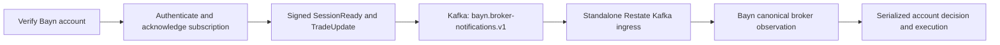

# Dorvud market data

Dorvud ingests market data, calculates technical signals, and archives source records and derived features.

- `websockets`: Alpaca WebSocket ingestion and Kafka publication, including source identity and bar revisions.
- `technical-analysis-flink`: the Flink technical-analysis job and the separate market-data archive job. The TA job
  consumes trades, quotes, and minute bars, produces microbars and technical signals, and publishes versioned rolling
  features for Bayn. The archive job writes raw records and published features to ClickHouse.
- `technical-analysis`: shared payloads, serializers, and calculation utilities used by the Flink job.
- `platform`: shared envelopes, timestamps, and Kafka configuration.
- `hyperliquid-feed`: the separate Hyperliquid ingestion module.
- [`webull-feed`](webull-feed/README.md): free Webull US stock/ETF ingestion into its own Kafka topic and raw archive.
- `flink-integration`: integration support.

Bayn consumes raw Kafka records and the feature topic. It owns strategy selection, risk, broker orders, accounting,
and reconciliation. Dorvud does not grant trading authority or establish strategy profitability.

## Bayn broker notifications

The separate `bayn-broker-feed` image runs `ai.proompteng.dorvud.ws.BrokerFeedMain` from the websockets module.
It uses Bayn's existing paper account secret and egress proxy. Before opening each socket, it calls Alpaca's account
endpoint with the loaded credentials and requires the returned account ID to match Bayn's configured account.
It then authenticates the socket and verifies the `trade_updates` subscription acknowledgement. The shared session
parser accepts Alpaca's text and binary JSON frames; the original update JSON retains decimal and timestamp precision.



Notifications carry a session ID, account identity hash, credential fingerprint, source revision and original receipt
time. HMAC-SHA256 over the exact message bytes uses the existing broker secret; the Kafka adapter receives only Kafka
credentials. The Kotlin/TypeScript contract is checked against `fixtures/bayn-broker-notification-v1.json`, which
contains synthetic credentials. These notifications request canonical account reconciliation; they never post fills,
fees or ledger transfers directly.

The producer awaits Kafka acknowledgement before reading the next update. A failed acknowledgement closes the session
and reconnects with a new verified `SessionReady`, allowing canonical gap repair. Updates can be delivered more than
once. Stable update IDs deduplicate transport retries; the financial stores retain their independent idempotency rules.
`/readyz` becomes ready only after the verified session notification has been acknowledged by Kafka, and resets on
disconnect. `/metrics` exposes `dorvud_broker_feed_ready`, publications and session failures without account labels.

Configuration requires `BAYN_ALPACA_ACCOUNT_ID`, `BAYN_ALPACA_KEY_ID`, `BAYN_ALPACA_SECRET_KEY`,
`BAYN_ALPACA_BASE_URL=https://paper-api.alpaca.markets`,
`BAYN_ALPACA_PROXY_URL=http://bayn-egress-proxy:3128`, the 40-character `DORVUD_SOURCE_REVISION`,
`BAYN_BROKER_NOTIFICATIONS_TOPIC=bayn.broker-notifications.v1`, and authenticated `KAFKA_BOOTSTRAP`,
`KAFKA_SECURITY_PROTOCOL`, `KAFKA_SASL_USER` and `KAFKA_SASL_PASSWORD`. Live broker destinations are rejected.
The existing Torghut collector retains its own account, topics and release path.

Run `./gradlew :websockets:ktlintCheck :websockets:test` for real local HTTP/WebSocket contract tests, including
wrong-account rejection, binary frames, failed publication, reconnect and the shared signature vector. Deployment and
runtime acceptance follow the [Bayn deployment guide](../../argocd/applications/bayn/README.md).

## Exception tracking

The forwarder, Flink TA and market-data archive report ERROR/FATAL logs and uncaught JVM exceptions to the
`proompteng/dorvud` GlitchTip project using pinned Sentry Java 8.61.0. The shared platform module owns ingestion
configuration and redaction. The forwarder uses its existing Logback logger. Flink uses its existing Log4j2 logger
in both JobManager and TaskManager processes. The image installs the small `dorvud-glitchtip.jar` in Flink's
global `lib/` directory, separate from the user-job jar, so framework failures reach the same reporting boundary.

`DORVUD_GLITCHTIP_DSN` must name the cluster-local GlitchTip web service on port 80 with a hexadecimal public
ingestion key. `DORVUD_ERROR_SERVICE` binds the forwarder, TA or archive role; release tags use the existing
Kargo-written commit variables. Requests, user data, extra values, breadcrumbs, contexts, thread dumps, source
snippets and exception messages are removed before transmission. Exception classes and stack frames remain.
Known component logger names survive as a bounded `logger` tag and part of issue grouping, including logs with no
throwable. Other logger names become `unknown`. Use the component, server and event timestamp to correlate the
redacted event with operational logs; provider messages and identifiers remain withheld.
Tracing, profiles, Sentry logs and automatic session tracking are disabled. Grafana, Loki and Mimir continue to
own operational telemetry. Missing ingestion configuration disables local exception reporting; invalid configured
destinations or roles are rejected.

Build and check the shared integration with:

```bash
./gradlew :platform:ktlintCheck :platform:test :platform:glitchtipJar :websockets:installDist :technical-analysis-flink:uberJar
```

After normal reviewed image publication and Kargo promotion, verify the actual revision and DSN on the forwarder
and both Flink process types. Run the explicit synthetic smoke once in each role and verify its GlitchTip event's
service, release, logger tag and exception stack frames. The smoke also sends a log-only event to verify that errors
without a throwable retain their component. It is never run automatically at service startup. In the forwarder, invoke:

```bash
java -cp '/app/lib/*' ai.proompteng.dorvud.platform.observability.GlitchTipSmoke
```

In each Flink process, invoke:

```bash
java -Dlog4j.configurationFile=/opt/flink/conf/log4j-console.properties \
  -Dlog.file=/tmp/glitchtip-smoke.log -cp '/opt/flink/lib/*' \
  ai.proompteng.dorvud.platform.observability.GlitchTipSmoke
```

Preserve existing checkpoint and savepoint identities, then verify restored jobs, completed checkpoints and fresh BTC/ETH/SOL features.
An SDK flush, healthy Pod or synthetic issue alone does not establish market-data or trading acceptance.

With `ENABLE_BARS_BACKFILL=true`, the WebSocket forwarder also reconciles provider bars every minute. This task remains
active after the market closes and while the WebSocket reconnects, refreshing requested symbols on each pass.
It first checks `BARS_BACKFILL_LOOKBACK_HOURS`,
then uses five-minute overlapping windows. It repeats the full lookback hourly and when the requested symbols change.
Every request page uses the same completed-minute cutoff. Each pass has a 60-second deadline.
Recovery runs on the blocking-I/O dispatcher and interrupts a blocked Kafka enqueue when canceled. Undispatched
batches retain enqueue order, and a bar is acknowledged only after Kafka confirms publication. A timeout or shutdown
does not pin the caller's dispatcher or mark an unacknowledged bar as recovered.

Recovery publishes only provider-supplied completed bars that this process has not acknowledged in Kafka. A failed
request, malformed page or failed acknowledgement leaves the scan incomplete for retry. It does not invent bars for
intervals the provider omits. Recovered envelopes keep `source=rest` and their actual recovery time, so they cannot
establish earlier live availability. Restarts repeat the bounded scan and may republish equivalent bars; consumers
retain their existing revision and duplicate handling. Recovery does not satisfy live WebSocket freshness gates.

During the regular IEX session, the core forwarder reconnects if no provider market-data event arrives within
`ALPACA_MARKET_DATA_READ_IDLE_TIMEOUT_MS` of the subscription or the last event. This check also runs when the WebSocket
keeps sending control frames. REST recovery cannot reset the provider-event clock.

Each market-data connection has one ten-second establishment deadline covering the HTTP upgrade, authentication and
complete subscription acknowledgement. Expiry cancels that attempt before the feed reconnects. The deadline ends at
authenticated acknowledgement, so healthy streams can continue indefinitely. Crypto publication also requires its
acknowledged channel membership; early frames cannot allocate sequences or enter Kafka.

## Crypto source events

The forwarder opens the Alpaca `v1beta3/crypto/{location}` websocket with the same `ALPACA_KEY_ID` and
`ALPACA_SECRET_KEY` used by the equity connection. `ALPACA_CRYPTO_SYMBOLS` supplies unique `BASE/QUOTE` pairs,
`ALPACA_CRYPTO_LOCATION` selects `us`, `us-1`, or `eu-1`, and `TOPIC_CRYPTO_EVENTS` names the Kafka topic.
The committed configuration collects `BTC/USD`, `ETH/USD`, and `SOL/USD` from `us`. It subscribes to trades, quotes,
minute bars, updated bars, and order books. Authentication, subscription acknowledgement, Kafka delivery,
freshness, and reconnect checks run on weekends and holidays. Sparse trades and updated bars require subscription
acknowledgement without inventing a minimum event rate. Quotes, minute bars, and order books require fresh delivery.

Crypto events use their native payload shape, independently of the equity decoder. The decoder validates pair
identity, timestamps, positive prices, fractional quantities, unsigned 64-bit trade IDs, taker side, bar consistency,
and order-book levels. Zero-volume midpoint bars may have zero VWAP. Order-book reset flags and zero-size deletions
remain intact. Numeric JSON literals retain their original text through Kafka serialization, including decimals
that cannot pass through `Double` exactly. Control frames do not advance the provider-event clock.

All crypto channels share one topic keyed by pair. Envelopes bind `provider=alpaca`, the location as `feed`,
`marketSession=continuous`, and `delayClass=real_time_crypto`. Sequence numbers order a pair's events within a process;
Kafka topic, partition, and offset identify retained records across restarts. The producer retains every validated
provider event, including repeated book snapshots. It does not reconstruct a book or supply REST replacements.

The existing archive job consumes this topic through its independent crypto source and checkpoint identities.
`ARCHIVE_CRYPTO_TOPIC`, `ARCHIVE_CRYPTO_LOCATION`, and `ARCHIVE_CRYPTO_SYMBOLS` bind the allowed source.
Its initial read starts at the earliest retained crypto offset. Existing archive sources keep their offsets and
restore identities. The archive revalidates the envelope and native payload before inserting into
`signal.crypto_market_events_v1`. The table stores nanosecond event and ingestion timestamps, native JSON,
sequence, and Kafka coordinates. Use `FINAL` or deduplicate by source coordinates when reading retries from the
at-least-once JDBC sink. Kafka retains seven days; ClickHouse retains thirty days.

Roll out the Kafka topic first. The Torghut schema hook creates the table, and the existing `signal_publisher` user
receives `INSERT` on that table. Reviewed image publication and Kargo promotion then deliver the archive and producer.
The production credentials remain in the existing secret references. To prove ingestion, compare native Kafka
records with ClickHouse rows by source coordinates and check BTC/USD, ETH/USD, and SOL/USD, all channels, exact payloads, and timestamp
precision. Readiness and a completed checkpoint alone do not prove this path.

The shared synthetic fixture is `fixtures/alpaca-crypto-v1.json`. `ForwarderCryptoTest` drives real local equity and
crypto websockets through the production forwarder and checks its Kafka sends and shared authentication.
`CryptoMarketDataArchiveTest` checks source binding, JDBC parameters, and savepoint identities.
`CryptoMarketDataClickhouseIntegrationTest` uses the existing guarded disposable ClickHouse service to exercise
the production schema and JDBC statement, including exact decimal payloads, nanosecond timestamps, and retry deduplication.
The provider contract is [Alpaca's real-time crypto data reference](https://docs.alpaca.markets/us/docs/real-time-crypto-pricing-data).

## Crypto Flink features

The raw crypto archive and derived features have separate contracts. The existing TA Flink job consumes
`bayn.market-data.crypto.v1` through its crypto feature branch. Native minute bars and updated bars drive rolling
price/volume features, EMA 12/26, MACD, RSI 14, Bollinger bands, five- and thirty-minute weighted closes and source VWAP,
and volatility over sixty log returns. Quotes, trades, and order books remain available in the raw archive; this
feature definition does not derive indicators from those channels.

`TA_CRYPTO_TOPIC`, `TA_CRYPTO_LOCATION`, and `TA_CRYPTO_SYMBOLS` bind the source. `TA_CRYPTO_FEATURES_TOPIC` selects
`bayn.market-data.crypto.features.v1`. The branch uses the existing TA Kafka credentials and starts at the retained
beginning on its first deployment. Its own source, keyed state, and sink IDs preserve the currently deployed equity
graph's checkpoint identities. The branch adds no Flink deployment or brokerage account.

`dorvud.crypto-continuous-1m.v2` runs across UTC midnight, weekends, and holidays. Messages use
`dorvud.crypto-market-feature.v2`. Their direct `priceWindow` contains exact decimal price and fractional volume
values from actual observed bars in the latest 30-minute context. The first real completed bar is sufficient;
missing historical minutes do not delay this price feature or create a 30-bar admission requirement.

Recursive indicators keep their
original seed as the bounded bar buffer advances. The last 61 canonical bars remain correctable; older corrections
are rejected and counted, while their raw records remain retained. A missing minute resets recursive warmup and makes
affected optional technical values `WARMING` or `GAP` according to their own lookback. The observed `priceWindow`
remains available through historical gaps. No missing bars are invented. Newer native updated bars replace their minute
by ingestion nanoseconds and then Kafka partition/offset, recomputing the current feature. Checkpoints retain the
recursive seed, canonical bars, hash chain, and last emitted semantic ID.

Feature messages contain readiness for each optional technical value, exact decimal observed price/volume values, technical
scalars in integer-string micros or ppm, actual computation time, producer revision, and raw source references.
Each reference binds nanosecond event/ingestion time, Kafka coordinates, and a native JSON content hash. A history
hash chain binds earlier canonical inputs that contribute to the recursive seed. The feature ID hashes canonical
material and excludes computation time and producer revision, so equivalent recovery produces the same semantic ID.

The archive consumes the derived topic with `ARCHIVE_CRYPTO_FEATURES_TOPIC`, validates its definition, source,
availability, and hashes, and writes the original message to `signal.crypto_market_features_v1`. The existing
`signal_publisher` identity receives only `INSERT` on the new table. Derived Kafka messages retain seven days and
ClickHouse retains thirty days. Readers deduplicate at-least-once retries by derived topic, partition, and offset,
using `FINAL` for the replicated replacing table. The topic and table keep their existing names; their native
feature payload must satisfy v2. Retired v1 feature payloads are not emitted or decoded.

Roll out the feature topic, then the schema/grant, then the Kargo-promoted TA and archive images. Acceptance requires
actual derived Kafka messages for BTC/USD, ETH/USD, and SOL/USD, raw-input joins and feature recomputation, exact ClickHouse payloads
on both replicas, and completed checkpoints after savepoint restore. A ready Pod or raw archive row does not prove
the derived path.

## Streaming equity source

The static core IEX connection subscribes to trades, quotes and bars for all sixteen configured Bayn symbols.
One authenticated socket and one admitted source map supply the three channels. Ordinary latest-quote/trade REST
acquisition and its temporary subscription qualifier are removed. There is no REST acquisition fallback.

The forty-eight-membership budget applies only to one static, sixteen-symbol equity IEX shard with exactly those
three channels and no per-channel overrides. Dynamic subscriptions, other core configurations and observation feeds
retain the thirty-membership budget. Provider rejection and incomplete acknowledgements leave the connection unready;
normal bounded recovery still applies. The initial rollout requires the retained same-socket qualification receipt:
all sixteen bars/quotes/trades acknowledged, 130 seconds of usable regular-session coverage, original provider times,
quote/trade ages and gaps within ten seconds, processing delay within one second, and verified baseline restoration.
A healthy connection outside regular hours does not establish this qualification.

Data from an unacknowledged or unconfigured equity membership is dropped before sequence allocation, deduplication,
channel freshness and Kafka publication. A reconnect starts with empty admitted memberships and requires fresh
authentication and subscription acknowledgement. `torghut.proompteng.ai/ws-config-generation` identifies the source
cutover; the Kargo-selected image and actual source-to-Bayn observations establish deployed behavior.

Named historical bar/trade gap repair remains separate and emits `source=rest`. Retained `source=rest_latest` point
samples remain excluded from both volume aggregators. Bayn's live consumer ignores those retired samples, including
records already accepted by Kafka before cutover, and records that exclusion in native arrival evidence. Earlier
captures retain their original sampled-record interpretation; current excluded records reproduce their exact receipt
and cannot become executable quotes or trades during replay. `fixtures/alpaca-latest-v1.json` remains a retained-data
fixture. Existing archives, provider event times, delivery times, offsets, Flink state, crypto and Webull remain intact.

Run the producer and consumer contract checks from this directory:

```sh
./gradlew :platform:test :websockets:test :technical-analysis:test :technical-analysis-flink:test
./gradlew :platform:ktlintCheck :websockets:ktlintCheck :technical-analysis:ktlintCheck :technical-analysis-flink:ktlintCheck
```

See [the Flink guide](technical-analysis-flink/README.md) and the
[Bayn streaming design](../../docs/bayn/streaming-market-data-design.md). Deployment follows reviewed main,
immutable publication, Kargo promotion and Argo reconciliation. Checkpoint restoration, full subscription coverage
and actual usable Bayn snapshots are separate acceptance checks; none establishes a profitable strategy.

## Producer stall diagnostics

Deduplication uses one bounded insertion-ordered store per cache. Expired keys are removed from that store;
duplicate hits neither extend their first-seen TTL nor move them to the back of the eviction order. Kafka delivery
callbacks retain only delivery metadata and an optional bar identity, not the decoded envelope. These bounds keep
normal TTL turnover and stalled broker acknowledgements from retaining obsolete keys or a second payload copy.
They do not make late records fresh or replace Kafka acknowledgement and source-provenance checks.

The websocket process binds Micrometer JVM memory, buffer, GC, and thread meters once at startup. Its GC observer
closes on shutdown, normal completion, and startup failure. Heap and thread gauges are sampled by the existing
`/metrics` scrape; GC pause counters and maxima come from JVM notifications. No new per-record timing or observer
loop runs in Kafka publication. Torghut Alloy retains these meters with the existing `job="torghut"`,
`namespace="torghut"`, `service="torghut-ws"`, and pod labels every thirty seconds.

Missing upstream market events keep readiness false without escalating channel starvation into a process restart.
The existing WebSocket idle watchdog owns reconnection. Authentication, Kafka and trade-update failures retain their bounded
liveness escalation, and market-data freshness checks remain required for readiness.

During a stall, align `torghut_ws_kafka_send_latency_seconds_{count,sum,max}`, send errors, readiness, pod restarts,
`jvm_memory_used_bytes{area="heap"}`, `jvm_memory_max_bytes{area="heap"}`, `jvm_gc_pause_seconds_{count,sum,max}`,
and `jvm_threads_states_threads` for the same pod and time window. The central collector also retains the producer's
three `container_cpu_cfs_*` counters. Divide the throttled-period rate by the total-period rate only when the
denominator is positive, then compare with CPU use and the configured limit. Do not treat an absent series as zero.
GC pause timers appear after a GC event; their window maximum is not a whole-session percentile. Container working
set includes memory outside the JVM heap. Exit 137 alone does not prove OOM; retain Kubernetes termination reasons,
probe-failure events, and previous-container logs alongside the metrics.

Local WS dev: copy `websockets/.env.local.example` to `.env.local`, fill Alpaca sandbox creds, and run `./gradlew :websockets:run` to stream into a local Kafka; `.env`/`.env.local` are auto-loaded (system env still wins). To get local infra only, run `docker compose -f websockets/docker-compose.local.yml up --build` for Kafka + UI, then start the forwarder separately with your env loaded; use symbol `FAKEPACA` for quick smoke.
